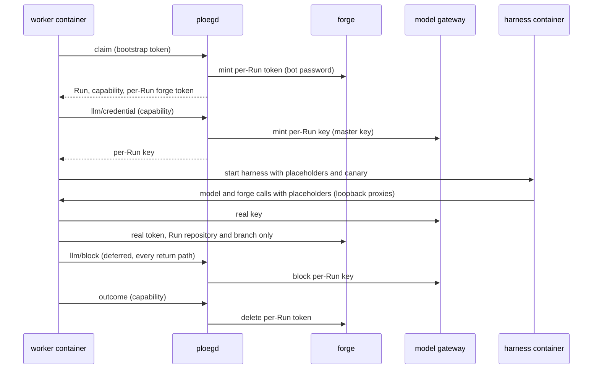

# Credential flow of a Run

Every credential a Run touches, who mints it, what it reaches, how long it lives, where it is held, and what ends it when the Run ends or crashes. It is the design record that issue [#17](https://github.com/ploeg-hq/ploeg/issues/17) (CNCF-017) asks for, and it ties together the [threat model](threat-model.md), the [worker-control contract](../contracts/worker-control.md) and the decisions [ADR-0013](../adrs/0013-push-rights-are-minted-per-run.md), [ADR-0086](../adrs/0086-github-is-a-forge-and-a-run-pushes-with-its-own-github-app-installation-token.md) and [ADR-0138](../adrs/0138-a-harness-runs-in-its-own-container-and-no-credential-enters-it.md).

It describes profile P1 of the threat model: managed worker authentication, both credential proxies on, the harness in its own container, and Forgejo 15 with a bot password or GitHub with an App. Outside P1 the harness may hold the real key and token; the threat model lists those workloads.

## The three places a credential can be

| Place | What it is | What reaches it |
| --- | --- | --- |
| ploegd | The controller process. Holds every management credential. | Nothing a worker or harness runs |
| worker container | `ploeg-worker`, the Run pod's main container. Holds the Run's capabilities and both loopback proxies. | The harness only through the launcher socket it accepts once, and through the loopback proxies, which forward only requests carrying the Run's placeholder |
| harness container | `ploeg-worker harness-serve` and the agent it starts. Mounts no Secret and has no environment of its own. | Placeholders, the canary and the work directory |

## Inventory

| Credential | Minted by | Scope | Lifetime | Held in | Revoked by | Run ends | Run crashes |
| --- | --- | --- | --- | --- | --- | --- | --- |
| LiteLLM master key (`LITELLM_MASTER_KEY`) | Operator, outside Ploeg | Every gateway key and team | Until rotated | ploegd only | Operator rotation | Unchanged | Unchanged |
| Forgejo bot password (`botPasswordSecret`) or GitHub App private key | Operator, outside Ploeg | Mints tokens for every repository the bot or App reaches | Until rotated | ploegd only | Operator rotation | Unchanged | Unchanged |
| Worker signing key (HMAC capability) and transaction-token signing key | Operator | Signs a capability for any running Run | Until rotated | ploegd only | Operator rotation; `PLOEG_WORKER_HMAC_CAPABILITY=off` retires the HMAC key | Unchanged | Unchanged |
| Bootstrap token (`PLOEG_WORKER_BOOTSTRAP_TOKEN`) | Operator, one per team and Role | `POST /api/v1/claim` for that team and Role only | No expiry | worker container (its own entry); ploegd holds the registry as SHA-256 compared values | Operator rotation of the Secret | Unchanged | Unchanged |
| Run capability: transaction token (ES256, ADR-0156) or the deprecated HMAC capability | ploegd, at claim, again at every renewal (transaction token) | One Run, its worker id, team and Role; only while the Run is `running` | Transaction token: the lease deadline. HMAC: at most 24 hours, and every request also checks the Run's state and deadline | worker memory | Implicit: ploegd refuses it once the Run is not `running` or its deadline passed | Refused from the moment the outcome is recorded | Refused once `ExpireRuns` reclaims the Run at its deadline |
| Per-Run model key | ploegd's managed LLM control (`POST /api/v1/runs/{token}/llm/credential`), on the worker's request | The Role policy's models, its budget cap, its LiteLLM team and MCP access groups; alias `ploeg-<run prefix>` | The policy TTL, at most 24 hours (live: 4 hours for writers and reviewers) | worker memory and its model proxy; the harness gets a placeholder | `POST /key/block` at the gateway, which ploegd calls for the worker's `llm/block` | The worker's deferred revoke on every return path, then ploegd's managed block sweep | `ExpireRuns` blocks it within one sweep interval (15 s) of the deadline; the 15-minute orphan sweep blocks any ploeg key without a live Run; the gateway TTL is the backstop |
| Per-Run forge token, Forgejo | ploegd's Forgejo broker at a Shift-scoped claim, signed in as the bot | `write:repository`, restricted to the Run's one repository; named `ploeg-run-<run prefix>-<owner>-<repo>` | No expiry: Forgejo's token API takes no lifetime | worker memory and its forge proxy; the harness gets a placeholder | `DELETE /api/v1/users/<bot>/tokens/<id>` | Deleted by ploegd when the outcome is recorded (`server.go`, after `ReportOutcome`) | `ExpireRuns` deletes it with the Run (the zombie-writer case of ADR-0013); the 15-minute orphan sweep deletes every `ploeg-run-` token whose Run holds no Lease, including one whose delete failed |
| Per-Run forge token, GitHub | ploegd's GitHub App broker | One repository; `contents:write`, `pull_requests:write`, `checks:read`, `statuses:read`, `metadata:read`; never `workflows` | One hour, enforced by GitHub; refreshed through `POST /api/v1/runs/{token}/forge-credential` 15 minutes before it expires | worker memory and its forge proxy | `DELETE /installation/token` | Revoked when the outcome is recorded | Revoked by `ExpireRuns`; a token whose handle ploegd lost in a restart ends at GitHub's expiry (F-15) |
| Shared builder token (`AGENT_BUILDER_TOKEN` from `tokenSecret`) | Operator | Write to every repository the bot can push to | Until rotated | worker container of writers | Operator rotation | Unchanged | Unchanged |
| Shared read token (`readTokenSecret`) | Operator | Read every repository the reading bot can read | Until rotated | worker container of readers | Operator rotation | Unchanged | Unchanged |
| Per-Run canary (`GITHUB_PAT`) | The worker | Nothing: shaped like a GitHub token, accepted by no forge | The Run | harness environment | Not needed | Discarded | Discarded |
| Placeholders (`LLM_API_KEY`, `AGENT_BUILDER_TOKEN` in the harness) | The worker, random per Run | The Run's own loopback proxy, nothing else | The Run | harness environment | The proxy stops when the Run ends | Dead | Dead with the pod |

Three of these deserve a note.

- **The shared builder token** is a fallback. A writer whose claim is not Shift-scoped, or whose Work Item resolved no target, gets no per-Run token and pushes with this one ([F-30](threat-model.md#findings)). In P1 every team has a Shift plan and every Work Item resolves a target, so a writer pushes with its per-Run token, but the shared token is still mounted in the worker container. ADR-0138 option (c) removes it.
- **The read token** is shared and long-lived on purpose (ADR-0013 tier 1): it cannot push, so a reviewer cannot write the branch it reviews. A reader has no forge proxy for pushes; a per-Run read token does not exist yet.
- **The bootstrap token** has no expiry. It reaches only the claim route for its own team and Role, and it never enters the harness container, but a leaked one claims paid Runs until the operator rotates it (AS3).

## One Run, end to end



Live, 2026-10-25, Run `ploeg-76b41121490b` (builder, `acp/openhands`, sandbox under Kata, release 0.2.0-rc.68), from the worker's own log in VictoriaLogs:

| Time (UTC) | Event |
| --- | --- |
| 12:41:41 | `claimed work item`, then `using a per-run forge credential minted for this run` |
| 12:41:52 | `forge token isolated behind the worker's loopback proxy` for `webgrip/homelab-cluster`; `minted per-run key`; `per-run key isolated behind the worker's loopback proxy` |
| 12:42:06 to 12:45:06 | Eleven `credential proxy refused a request` lines from the hostile steps ([requalification](../research/2026-10-25-credential-proxy-requalification.md)) |
| 12:47:16 | `revoked per-run key`, after the harness exited and before verification |
| 12:47:40 | `outcome reported`; ploegd deletes the per-Run forge token on this call |
| 12:57:24 | ploegd's next orphan sweep: `forge orphan sweep: no stale push credentials found` |

The sweep at 12:57:24 lists every token of the bot on the live forge and deletes any `ploeg-run-` token whose Run holds no Lease. It found none, so the Run's token was gone from the forge within ten minutes of the outcome, deleted by the settle path. Successful deletes are not logged; only failures are (`forge credential revoke failed; the forge sweep will retry`), and none was logged for this Run.

## How the broker knows a Forgejo token is restricted

Forgejo restricts a token to named repositories from 15.0.0. The create request's `repositories` field and the `repositories` field of the created `AccessToken` both arrived then ([`modules/structs/user_app.go`](https://codeberg.org/forgejo/forgejo/src/tag/v15.0.10/modules/structs/user_app.go) lines 19 to 35). The handler stores one restriction row per named repository and answers with those repositories; with no `repositories` in the request it marks the token as reaching every repository and answers `null` ([`routers/api/v1/user/app.go`](https://codeberg.org/forgejo/forgejo/src/tag/v15.0.10/routers/api/v1/user/app.go) lines 178 to 214 and 237 to 244). Forgejo 14 has neither field ([v14.0.0](https://codeberg.org/forgejo/forgejo/src/tag/v14.0.0/routers/api/v1/user/app.go)), so it ignores the restriction the broker asks for and mints a token for every repository the bot can reach, without an error.

ploegd therefore checks twice ([ADR-0172](../adrs/0172-the-forgejo-broker-runs-only-on-forgejo-15-and-refuses-a-token-the-forge-did-not-restrict-to-the-runs-repository.md)):

* **At start.** With `PLOEG_FORGEJO_BOT_PASSWORD` set, ploegd reads `GET /api/v1/version` and stops when the major version is below 15 or the version does not read as Forgejo's, with an error naming the forge URL and the version found, for example `"14.0.2+gitea-1.22.0"`. It also stops when the version cannot be read. On success it logs `per-run forge credentials enabled` with `forgejo_version`.
* **At every mint.** The broker reads `repositories` from the created token. Unless it names exactly the Run's repository, the broker deletes the token by name and the claim fails: the worker gets no token and the Run ends `failed` with `infra_node`. If the delete fails, the Run no longer holds a Lease, so the orphan sweep deletes the token.

What this does not prove is that Forgejo enforces the restriction it reports. The [live qualification](#qualification-against-a-live-forge), given a second repository, does.

## What a revocation takes away, and when

A per-Run credential is useful only while the forge or gateway accepts it. Whether a revoked one is refused on the next request depends on the forge and gateway, not on Ploeg.

**Forgejo 15.0.10** (the forge in the maintainer's homelab). Every token request, as an `Authorization: token` header ([`services/auth/method/oauth2.go`](https://codeberg.org/forgejo/forgejo/src/tag/v15.0.10/services/auth/method/oauth2.go) line 182) or as a git Basic password ([`basic.go`](https://codeberg.org/forgejo/forgejo/src/tag/v15.0.10/services/auth/method/basic.go) line 91), goes through `GetAccessTokenBySHA` ([`models/auth/access_token.go`](https://codeberg.org/forgejo/forgejo/src/tag/v15.0.10/models/auth/access_token.go) lines 148 to 191). Its in-memory cache of successful lookups maps a token only to a row id, and the function reads that row from the database on every request, dropping the cache entry when the row is gone. `DeleteAccessTokenByID` deletes the row and its repository restrictions in one transaction. So a revoked token is refused on the first request after the delete call returns, on every replica, with no cache window.

**GitHub.** ADR-0086's opt-in `TestQualificationAGitHubRunDeliversAPullRequest` revokes the per-Run installation token and proves it dead against github.com.

**LiteLLM v1.105.3** (the gateway in the maintainer's homelab, one replica). `POST /key/block` sets `blocked` on the key's row and then deletes the key from the key cache ([`key_management_endpoints.py`](https://github.com/BerriAI/litellm/blob/v1.105.3/litellm/proxy/management_endpoints/key_management_endpoints.py) `block_key`). With one replica that cache is the only one. Several replicas that share no Redis each keep their own in-memory cache; a blocked key can then pass on another replica until that replica's cache entry expires. The per-Run key's budget cap holds either way.

**What Ploeg adds.** The forge proxy keeps sending the token it holds; after a revoke it passes the forge's 401 back to the harness and logs `the forge refused the Run's credential behind the proxy` with the Run, method, path and status (T-FG-2). `TestARevokedPerRunTokenIsRefusedByTheForgeAndTheProxyPassesTheRefusalOn` proves that path against a fake Forgejo that honours revocation.

## Qualification against a live forge

`TestQualificationARevokedForgejoRunTokenIsRefusedAtOnce` ([`pkg/forgebroker/qualification_test.go`](../../pkg/forgebroker/qualification_test.go)) is opt-in like the GitHub qualification. Against a real Forgejo it mints a per-Run token through the broker, proves the token reads the repository API and git push discovery (and, given a second repository, that it cannot read that one), deletes it, and then replays it five times against both routes. Every replay must answer 401, and the token must be gone from the bot's token list. It logs how long the revoke took and when the first refusal came, never the token. Run against a fake that honours revocation it passes; against one that ignores the delete it fails on the first replay.

Status on 2026-10-26: **qualified against the live forge.** The maintainer's homelab runs the same sequence in-cluster as a worker-labelled Job, `forge-revocation-probe`, which reads the bot password from the Secret that ploegd's broker uses, so the value never leaves the pod. Against Forgejo `15.0.10+gitea-1.22.0` it minted a token for `agent-builder`, read `GET /api/v1/user` and git discovery of a repository with it (200 and 200), revoked it (204), and replayed it five times against both routes: every replay answered 401, the first within 10 ms of the revoke returning (the probe's clock resolution), and the token was gone from the bot's token list. The Job reruns weekly. The opt-in test runs the same steps through Ploeg's broker for an installation that wants the proof from its own machine:

```sh
umask 077
kubectl -n ploeg get secret agent-builder-password -o jsonpath='{.data.FORGEJO_BOT_PASSWORD}' | base64 -d > /tmp/ploeg-bot-password
PLOEG_FORGEJO_E2E_URL=https://forgejo.webgrip.dev \
PLOEG_FORGEJO_E2E_BOT=agent-builder \
PLOEG_FORGEJO_E2E_PASSWORD_FILE=/tmp/ploeg-bot-password \
PLOEG_FORGEJO_E2E_REPO=<owner/repo the bot can write> \
PLOEG_FORGEJO_E2E_OTHER_REPO=<owner/repo the bot can read> \
  mise exec -- go test -count=1 -v -run TestQualificationARevokedForgejoRunTokenIsRefusedAtOnce ./pkg/forgebroker/
rm -f /tmp/ploeg-bot-password
```

The Secret and key names are the maintainer's homelab's; another installation uses the Secret its `botPasswordSecret` names. The test leaves no token behind: it revokes in a deferred call as well. The live probe's token was a plain user token, not one restricted to a repository, so it shows that Forgejo refuses a revoked token at once; that the broker's restricted token is refused the same way rests on the source reading above, since both go through `GetAccessTokenBySHA`. The opt-in test mints through the broker, so on a forge that does not report the restriction it fails at the mint with `the forge did not restrict the per-run token`; with `PLOEG_FORGEJO_E2E_OTHER_REPO` it also requires the other repository to answer 403 or 404. That run through the broker has not yet been recorded here (F-10's residual).

## What is left

| Gap | Where it is tracked |
| --- | --- |
| The shared builder token and the bootstrap token stay in the worker container | ADR-0138 option (c); F-03's residual |
| Readers share one long-lived read token | ADR-0013 tier 1, ADR-0138 follow-ups |
| A Forgejo per-Run token has no expiry; the sweep is the only backstop for a failed delete | ADR-0013 re-evaluation trigger (Forgejo native token expiry) |
| The broker checks the restriction Forgejo reports on each token, not that Forgejo enforces it; the live qualification with a second repository has not yet run through the broker | [F-10](threat-model.md#findings), [ADR-0172](../adrs/0172-the-forgejo-broker-runs-only-on-forgejo-15-and-refuses-a-token-the-forge-did-not-restrict-to-the-runs-repository.md) |
| GitHub token handles are lost on a ploegd restart | [F-15](threat-model.md#findings) |
| GitLab has no per-Run broker | [F-31](threat-model.md#findings) |
| Proxy refusals reach the worker log only, not ploegd's audit log | T-WK-1 |
