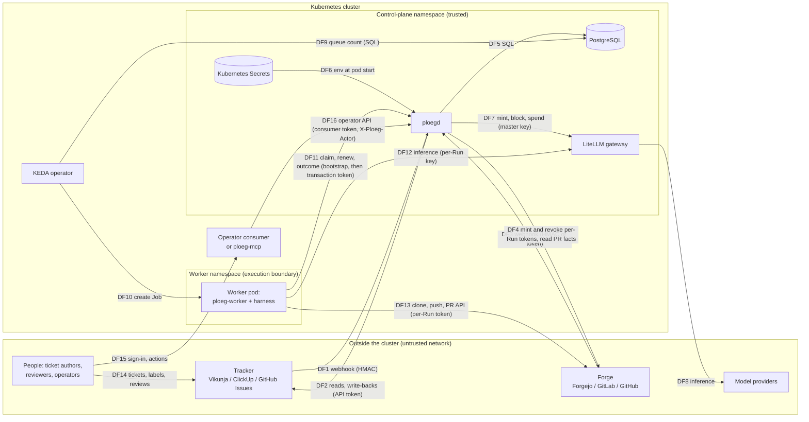
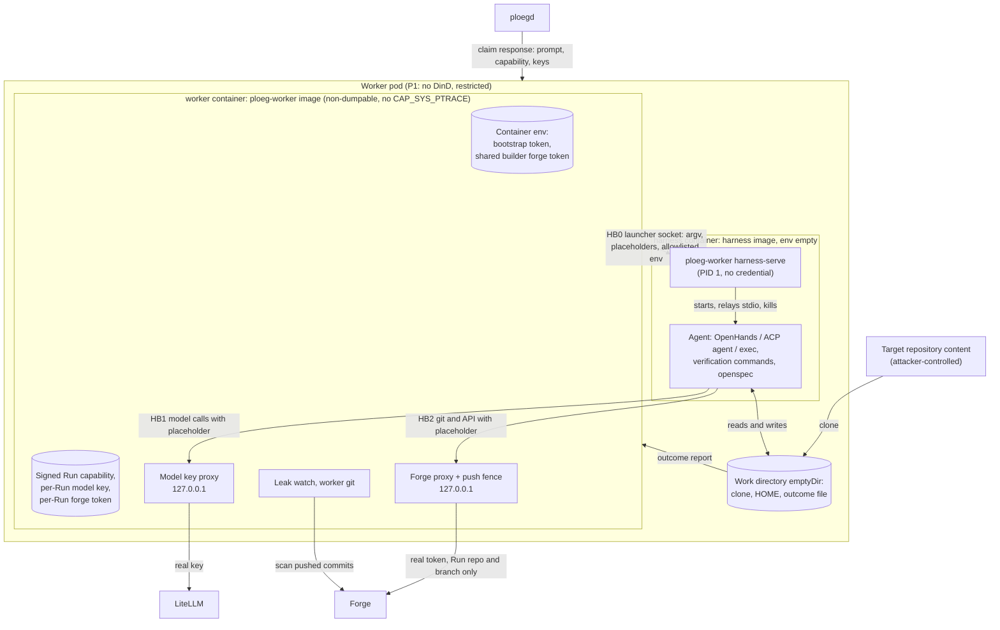

# Ploeg threat model

This is the threat model for the deployment profile Ploeg intends to support first (issue #15). It was written by the project and has not been reviewed by anyone independent of it. The [security self-assessment](self-assessment.md) builds on it.

Source revision: `development` at `c37de7f` (2026-10-23). Every mitigation listed below was checked against that source unless its row says **doc only**. Every finding that is not fixed was re-read against `development` at `8e98500` on 2026-10-26; the line numbers of that pass are in [Finding dispositions](#finding-dispositions). Where the documentation and the code disagree, the code wins and the disagreement is listed in [Where the documentation and the code disagree](#where-the-documentation-and-the-code-disagree).

## Method

CNCF TAG Security and Compliance does not prescribe a threat-modeling method. Its [security assessment guide](https://github.com/cncf/tag-security/blob/main/community/assessments/guide/README.md) asks a Sandbox project to document "their threat model and security design". The [Cloud Native Security Whitepaper v2](https://github.com/cncf/tag-security/blob/main/community/resources/security-whitepaper/v2/cloud-native-security-whitepaper.md), in its Threat Modeling section, asks for three things:

- a scoped representation of the architecture, with processes, data stores and security boundaries;
- threat identification with "a mature, well-used model of threats such as STRIDE or OCTAVE";
- the actor classes malicious insider, uninformed insider and malicious outsider.

It builds this on the four-step [OWASP threat modeling](https://owasp.org/www-community/Threat_Modeling) process. The completed TAG assessments of [External Secrets Operator](https://github.com/cncf/tag-security/blob/main/community/assessments/projects/external-secrets/docs/stride-threat-model.md), Guardon and others use STRIDE. All of these sources were read on 2026-10-23.

This model therefore uses:

- **STRIDE per element.** It is applied to data-flow diagrams that draw the trust boundaries explicitly. STRIDE is the method the whitepaper names first and the one TAG reviewers already read. Applying it per element ties each threat to a component and a data flow, so a reviewer can check it against the code.
- **Attack trees.** They cover the four attacker goals that matter most for an agent dispatch plane, so that combinations of threats are visible.
- **The OWASP AI risk lists.** Each threat that comes from model-directed execution is mapped to the [OWASP Top 10 for LLM Applications 2025](https://genai.owasp.org/llm-top-10/) (`LLM01` to `LLM10`) and the [OWASP Top 10 for Agentic Applications 2026](https://genai.owasp.org/2025/12/09/owasp-top-10-for-agentic-applications-the-benchmark-for-agentic-security-in-the-age-of-autonomous-ai/) (`ASI01` Agent Goal Hijack to `ASI10` Rogue Agents). Ploeg runs an agent on input it does not control, so these risks are first-class.
- **The four questions of the [Threat Modeling Manifesto](https://www.threatmodelingmanifesto.org/).** They give the document its order: what are we working on (profile, diagrams, assets), what can go wrong (STRIDE, attack trees), what are we going to do about it (mitigations, findings), and did we do a good enough job (verification and open questions).

Likelihood and impact use three levels, and severity is read from this matrix:

| Likelihood \ Impact | Low | Medium | High |
| --- | --- | --- | --- |
| **High** | Medium | High | Critical |
| **Medium** | Low | Medium | High |
| **Low** | Low | Low | Medium |

- *Impact High* means credential theft beyond one Run, escape from the pod, a change published without review, or spend beyond the authorized budget.
- *Likelihood High* means a remote or repository-supplied attacker can do it with no further foothold.

## The supported deployment profile

**Status: confirmed by the maintainer on 2026-10-25 ([#15](https://github.com/ploeg-hq/ploeg/issues/15)).** Profile P1 is the deployment profile Ploeg supports. This model assumes the profile below. A deployment outside it is not covered here. The chart refuses values that leave it unless they set `supportProfile: unsupported`, for every row it can see; the rows it cannot see stay with the installer ([F-11](#findings), [ADR-0154](../adrs/0154-the-chart-refuses-values-that-leave-profile-p1-unless-they-declare-the-deployment-unsupported.md)).

### Profile P1: unattended workers without Docker, credential proxies on

| Axis | Required setting | Where it is set |
| --- | --- | --- |
| Controller | One `ploegd` replica, chart defaults (non-root, read-only root filesystem, no service-account token) | [deployment.yaml](../../ops/helm/ploeg/templates/deployment.yaml) |
| Worker authentication | `executor.workerAuth.mode: managed`, with signing key and bootstrap registry from Secrets | [worker control](../contracts/worker-control.md) |
| Executor | `executor.type: keda` (KEDA ScaledJob) or `cronjob`, or `sandbox` (globally or per team) when every sandbox workload resolves a `runtimeClassName` whose handler gives each pod its own VM, such as Kata Containers, with the guest's seccomp enabled (Kata `disable_guest_seccomp=false`, [F-41](#findings)). The sandbox executor needs agent-sandbox and brings the launcher's `sandboxclaims` role into scope ([F-21](#findings)) | [values.yaml](../../ops/helm/ploeg/values.yaml), [_sandbox.tpl](../../ops/helm/ploeg/templates/_sandbox.tpl) `ploeg.runtimeClassName` |
| Harness | One in `ploeg.isolationQualifiedHarnesses` (`openhands`, `acp/openhands`, `exec`) | [_helpers.tpl](../../ops/helm/ploeg/templates/_helpers.tpl) lines 174 to 180 |
| Docker | `harness.dind: false` on every team and Role, the chart default since [PR #231](https://github.com/ploeg-hq/ploeg/pull/231) ([ADR-0136](../adrs/0136-the-chart-default-is-the-strict-isolation-profile-and-privileged-dind-is-an-acknowledged-opt-in.md)) | values |
| Credential proxies | `executor.litellm.keyIsolation: proxy` and `executor.forgeTokenIsolation: proxy`, no `credentialIsolation` override | values |
| Harness container | `executor.harnessContainer: separate`, the chart default since ADR-0138: the harness in its own native sidecar, the worker container from the ploeg-worker image | [ADR-0138](../adrs/0138-a-harness-runs-in-its-own-container-and-no-credential-enters-it.md) |
| Worker and harness containers | Default `executor.workerSecurityContext` on the harness container (uid 1000, no privilege escalation, no capabilities, `RuntimeDefault` seccomp) and the derived worker container context (the same uid, a read-only root filesystem) | [ADR-0120](../adrs/0120-a-worker-container-meets-the-restricted-pod-security-standard-by-default.md) |
| Images | Every image a worker pod runs pinned by digest (`<reference>@sha256:<digest>`): the harness image, each toolchain image, the worker and worker-bin images, the sandbox launcher's image. The published chart stamps the digests of its own images at release; the agent and toolchain images are the installer's to pin ([#299](https://github.com/ploeg-hq/ploeg/issues/299)) | values, chart guard [_support_profile.tpl](../../ops/helm/ploeg/templates/_support_profile.tpl) |
| Namespace | Pod Security Admission `enforce: restricted` on the worker namespace | installer |
| Forge | GitHub with a GitHub App (per-Run installation tokens), or Forgejo 15 or later with `botPasswordSecret` (per-Run repository tokens) | [ADR-0013](../adrs/0013-push-rights-are-minted-per-run.md), [ADR-0086](../adrs/0086-github-is-a-forge-and-a-run-pushes-with-its-own-github-app-installation-token.md) |
| Teams and targets | Every team has a Shift plan, and every Work Item resolves a Work Target. Only the Shift-scoped claim mints a per-Run forge token; a plan-less claim or an untargeted Work Item falls back to the shared builder token ([server.go](../../pkg/httpapi/server.go) lines 637 to 655 and 713 to 726) | values, `config` |
| Reading Roles | `readTokenSecret` set, so readers never hold a write token | chart guard `reject-reader-without-read-token` |
| Forge follow-ups | With `forgeFollowUps.reworkOnChangesRequested` on, only reviewers in `reworkReviewers` or with write access on the forge send work back, up to `maxReworks` times per Work Item ([F-36](#findings), fixed) | `config.teams` |
| Webhooks | A webhook secret for every tracker and forge that sends events | [ci-and-infra](../ops/ci-and-infra.md#forge-webhooks) |
| Network | The chart's default-deny NetworkPolicies, `networkPolicy.enabled: true`, on a CNI that enforces them ([network policies](../ops/network.md)); the paths below are what they allow | [templates/networkpolicy.yaml](../../ops/helm/ploeg/templates/networkpolicy.yaml), installer's CNI |
| Transport | ploegd reached in-cluster only. The internet reaches only `/webhooks/*`, through a TLS-terminating gateway. Pod-to-pod traffic is encrypted by the CNI or a mesh when it crosses nodes | installer |
| Model gateway | LiteLLM 1.103.0 or later with spend logs on; the master key only in ploegd | [managed workers](../ops/managed-workers.md) |

The worker namespace needs these network paths and no others. The chart renders each of them from its URL values ([network policies](../ops/network.md)); the KEDA row is the installer's, because the KEDA operator is not a Ploeg pod:

| From | To | Port | Why |
| --- | --- | --- | --- |
| worker pods | cluster DNS | 53 | name resolution |
| worker pods | ploegd Service | 8080 | claim, renew, outcome, credential refresh |
| worker pods | LiteLLM proxy | 4000 | inference with the per-Run key |
| worker pods | forge HTTP(S) | 443 or the forge's port | clone, push, pull request API |
| ploegd | PostgreSQL | 5432 | state |
| ploegd | LiteLLM admin, forge API, tracker API | their ports | management, minting, write-backs |
| gateway | ploegd | 8080, path `/webhooks/*` only | tracker and forge events |
| KEDA operator | PostgreSQL | 5432 | queue depth, as a least-privilege role |

### What the profile excludes

| Excluded | Why |
| --- | --- |
| `harness.dind: true` (an opt-in that renders only with `harness.acknowledgePrivilegedDind: true`; the default is `false` since PR #231) | Privileged sidecar whose client certificates the harness holds. It also turns both credential proxies off ([F-01](#findings)). |
| `executor.workerAuth.mode: legacy` | Unauthenticated worker routes, static inference key, no managed accounting ([F-22](#findings)) |
| `claude-code`, `acp/opencode`, `acp/qwen-code`, `acp/goose`, `acp/custom` | Not qualified with both proxies on ([qualification record](../research/2026-10-04-isolation-qualification.md)) |
| `claude-environment` and the `claudeRunner` | The Run executes outside the pod on a third-party runner. The login is a person's credential. The Claude-session exchange mints a forge token without naming the forge ([F-31](#findings)). |
| `executor.type: sandbox` on a workload without a `runtimeClassName` | The agent pod then shares the node's kernel like a `keda` worker, while the launcher still holds a namespace-wide `sandboxclaims` role ([F-21](#findings)). The chart cannot tell a VM runtime class from any other by its name, so naming one whose handler is not a VM (gVisor, runc) is outside P1 on the installer's word. |
| A VM runtime class whose guest seccomp is off (Kata `disable_guest_seccomp=true`, as the kata-containers 3.32.0 Talos extension ships it) | The VM boundary holds, but the `RuntimeDefault` seccomp filter P1 lists for worker containers is not enforced inside the guest. The chart cannot see the runtime's configuration; [`worker-boundary-probe.sh`](../../scripts/worker-boundary-probe.sh) fails on it ([F-41](#findings)). |
| Static shared forge token for writers (no App, no bot password) | It cannot be scoped per Run or revoked |
| GitLab as a forge | No per-Run GitLab broker exists; GitLab writers always use the shared token, and in a mixed deployment a GitLab Run's mint is routed to the Forgejo broker ([F-31](#findings)) |
| Delegated Operator Executions | Being retired ([ADR-0102](../adrs/0102-an-operator-consumer-admits-work-items-that-ploeg-worker-executes.md)) |
| `ploeg-mcp` groups with `execute` | The forged-confirmation bypass is fixed ([F-08](#findings), [ADR-0152](../adrs/0152-ploeg-mcp-signs-each-confirmation-and-acts-on-it-once.md)), and with `PLOEG_MCP_CONFIRMATION_MODE=login` ([ADR-0153](../adrs/0153-a-person-confirms-a-ploeg-mcp-action-by-signing-in-afresh-at-a-ploeg-mcp-page.md)) each action needs the person's fresh sign-in at a ploeg-mcp page, which a client answering its own elicitations cannot produce. Once that ships and is configured, with a required phishing-resistant `amr` or `acr`, `execute` groups can join P1; that is the owner's call and they are not in it yet. Without `login` mode (unset or `elicitation`) a client that answers its own elicitations can still act. The group's consumer token stays a shared credential unless the exchange of ADR-0150 is on. Read-only groups are in scope. |
| Registry egress (`registries` profile, [ADR-0037](../adrs/0037-teams-opt-into-registry-egress-through-a-logged-allowlist-proxy.md)) | Enforcement lives outside the chart and is not modelled here |

## Data-flow diagrams

### Level 0: context

### Level 1: inside the worker pod

The worker pod holds the weakest boundary in the system. Since [ADR-0138](../adrs/0138-a-harness-runs-in-its-own-container-and-no-credential-enters-it.md) the harness runs in its own container: `harness`, a native sidecar from the harness image whose only process tree is `ploeg-worker harness-serve` and what it starts, and `worker`, the Job's main container from the ploeg-worker image, which holds every credential and both proxies. The two run as the same uid, share the work directory and the network namespace, and have separate PID and mount namespaces and root filesystems. A workload outside P1 (DinD, a proxy off, `claude-environment`, or `harnessContainer: shared`) keeps the older shape: one container, separated by process only.

### Trust boundaries

| ID | Boundary | What enforces it |
| --- | --- | --- |
| TB1 | Internet and external SaaS to the cluster | Gateway TLS and installer routing. Webhook HMAC in ploegd. |
| TB2 | Control-plane namespace to worker namespace | Separate pods. Worker pods mount no service-account token. Controller-only Secrets are wired only to ploegd ([_worker_control.tpl](../../ops/helm/ploeg/templates/_worker_control.tpl)). The chart's NetworkPolicies let a worker reach ploegd on 8080 and nothing reach a worker ([network policies](../ops/network.md)); enforcement is the CNI's ([F-02](#findings)). |
| TB3 | `ploeg-worker` to harness, two containers of one pod | A container boundary since [ADR-0138](../adrs/0138-a-harness-runs-in-its-own-container-and-no-credential-enters-it.md): the harness container has its own PID and mount namespace and root filesystem, mounts no Secret and gets no secret environment, and reaches the worker only through the launcher socket the worker accepts once and removes. Inside it, the environment allowlist, placeholders and loopback proxies still apply; `PR_SET_DUMPABLE=0` and the ptrace shed remain as a second layer. The network namespace is shared, so loopback is common to both ([F-24](#findings)). A workload with `harnessContainer: shared` keeps the older process boundary ([F-03](#findings)). |
| TB4 | Pod to node | Container runtime (runc in P1), `restricted` Pod Security, seccomp `RuntimeDefault` |
| TB5 | Operator consumer to ploegd | Consumer bearer token or a person token exchanged for Ploeg's audience (ADR-0150), team scope, `execute` and `verify` flags. Person identity is proven by a person token, otherwise asserted by the consumer ([F-07](#findings)). |
| TB6 | ploegd to the model gateway and forge | Per-Run keys and tokens with scope, budget and expiry set by ploegd |

## Assets

| ID | Asset | Where it lives | Why it matters |
| --- | --- | --- | --- |
| AS1 | LiteLLM master key | ploegd env (`LITELLM_MASTER_KEY`) | Unlimited model spend and key administration |
| AS2 | Worker signing key (deprecated with the HMAC capability, ADR-0156) | ploegd env (`PLOEG_WORKER_SIGNING_KEY`); unset with `PLOEG_WORKER_HMAC_CAPABILITY=off` | Forges a capability for any running Run |
| AS3 | Bootstrap registry and per-team bootstrap tokens | ploegd env (whole registry); each worker container (its own entry) | Claims paid work for a team and Role; no expiry |
| AS4 | Forge bot password (Forgejo) or GitHub App private key | ploegd env | Mints write tokens for every repository the bot or App can reach |
| AS5 | Shared builder forge token (`agent-builder-token`) | ploegd and every writer worker container | Long-lived write access to every repository the bot can push to |
| AS6 | Per-Run model key | ploegd (minted), worker memory, gateway | Spend up to the Run's cap until blocked or expired |
| AS7 | Per-Run forge token | worker memory and forge | Push and pull request rights on one repository |
| AS8 | Run transaction token, and the deprecated HMAC Run capability while issued | worker memory | Acts on one Run while it runs, only with the worker id it names: the transaction token until its lease deadline (ADR-0156), the HMAC capability for at most 24 hours |
| AS9 | Operator consumer tokens | ploegd env (SHA-256 compared); consumer | Admission, cancel, steer, claim within the consumer's scope and budget |
| AS10 | Tracker and forge API tokens, webhook secrets | ploegd env | Write-backs to boards; forging events |
| AS11 | Database credentials and contents (Work Item text, transcripts, notes, audit, spend) | PostgreSQL | Integrity of authorization and accounting; confidentiality of ticket text |
| AS12 | Target repository branches and pull requests | forge | Integrity of what reviewers merge |
| AS13 | Authorized budget and settled spend | PostgreSQL, gateway spend logs | Financial loss |
| AS14 | The node and other pods | cluster | Lateral movement |
| AS15 | Release artifacts (images, chart, signatures) | ghcr.io, GitHub Releases, Rekor | Supply chain for every installer |
| AS16 | Transaction token signing key | ploegd env (`PLOEG_TRANSACTION_TOKEN_SIGNING_KEY`); public half at `/.well-known/jwks.json` | Signs a worker credential for any running Run, naming any person as the one it acts for (ADR-0156) |

## Actors

The whitepaper's three classes are refined into the actors that touch Ploeg.

| ID | Actor | Class | Capability assumed |
| --- | --- | --- | --- |
| AC1 | Internet attacker | malicious outsider | Reaches anything the gateway exposes; can send webhooks |
| AC2 | Author of hostile repository content | malicious outsider | Controls files in a repository a Run clones: instructions, configs, hooks, symlinks, scripts |
| AC3 | Ticket author or tracker writer | uninformed or malicious insider | Writes Work Item text; may assign or label work when the tracker allows it |
| AC4 | Hijacked agent (the harness after prompt injection) | malicious insider inside TB3 | Arbitrary code as uid 1000 in the harness container, the work directory, network as the pod |
| AC5 | Compromised or careless operator consumer | malicious or uninformed insider | Holds a consumer token; names any person in `X-Ploeg-Actor` |
| AC6 | Other workload in the cluster | malicious insider | Pod network access, no Ploeg credentials |
| AC7 | Supply-chain attacker | malicious outsider | Compromises a dependency, agent image, action or the maintainer's account |
| AC8 | Installer or operator who misconfigures | uninformed insider | Sets chart values, Secrets and cluster policy |

## Entry points

| ID | Entry point | Authentication | Reference |
| --- | --- | --- | --- |
| EP1 | `POST /webhooks/tracker/{provider}` | HMAC-SHA256 (Vikunja, ClickUp, GitHub Issues); rejected without a secret | [server.go](../../pkg/httpapi/server.go) line 240; provider `hmac.Equal` at vikunja.go:167, clickup.go:228, githubissues.go:347 |
| EP2 | `POST /webhooks/forge/{provider}` | HMAC (Forgejo, GitHub); shared token (GitLab) | forgejo.go:611, github/webhook.go:214, gitlab.go:512 |
| EP3 | `POST /api/v1/claim` | Bootstrap token (SHA-256, constant time), worker id, team and Role must match | [worker_auth.go](../../pkg/httpapi/worker_auth.go) lines 69 to 165 |
| EP4 | `/api/v1/runs/{token}/*` incl. `llm/*` and `forge-credential` | ES256 transaction token (ADR-0156) bound to the Run id, worker id (`req_wl`), Team and Role and expiring at the lease deadline, or, while `PLOEG_WORKER_HMAC_CAPABILITY` is `issue`, the deprecated HMAC capability bound to run token, worker id, Team and Role; Run must be `running` and before its deadline | `WorkerHandler` in [worker_auth.go](../../pkg/httpapi/worker_auth.go); `verifyTransactionToken` in [transaction_token.go](../../pkg/httpapi/transaction_token.go) |
| EP5 | `/api/v1/operator/*` | Consumer bearer token (SHA-256, constant time), team scope, `execute`/`verify` flags | [operator.go](../../pkg/httpapi/operator.go) lines 134 to 189 |
| EP6 | `/api/v1/deploys` | Deploy bearer token, 404 when unset | [deploys.go](../../pkg/httpapi/deploys.go) lines 44 to 55 |
| EP7 | `POST /api/v1/claude-sessions/*` | Session JWT (excluded from P1) | `pkg/claudesession` |
| EP8 | `GET /healthz`, `/readyz`, `/metrics` | None; aggregate state, team names, spend per hour | server.go lines 237 to 239 |
| EP9 | `GET /api/v1/queue/{team}` | Rejected in managed mode; open in legacy mode | worker_auth.go lines 116 to 124 and 169 to 172 |
| EP10 | ploeg-mcp `:8090` | OAuth access token (JWKS, issuer, `aud`/`azp` = client id, `ploeg:read`) | `pkg/mcpauth` |
| EP11 | Target repository content | None: it is attacker input by design | [attack drill](../ops/attack-drill.md) |
| EP12 | Work Item text from the tracker | Webhook HMAC proves the tracker sent it, not who wrote it | [taskprompt/prompt.go](../../pkg/taskprompt/prompt.go) lines 58 to 61 |

## STRIDE per element

Each row names the threat, the AI-risk mapping where one applies, likelihood (L) and impact (I), the mitigation and its evidence, and the residual risk. The verification owner is the maintainer role that must prove the mitigation and keep proving it. With one maintainer, each role is that person; the role is named so that the work can move when people join.

### ploegd (process)

| ID | STRIDE | Threat | L / I | Mitigation and evidence | Residual | Verification owner |
| --- | --- | --- | --- | --- | --- | --- |
| T-PD-1 | S | Forged tracker or forge webhook queues paid work or settles a pull request | L / H | HMAC per provider, constant-time; no secret means every delivery is rejected (EP1, EP2 references) | Low. GitLab uses a shared token, not a body MAC. | control plane |
| T-PD-2 | S, R | Replay of a captured signed webhook re-queues finished work or settles a reopened pull request. Delivery-id headers are not signed; Vikunja, ClickUp and GitLab have no dedupe; no timestamp window. | M / M | Dedupe on `X-GitHub-Delivery` and `X-Forgejo-Delivery` only ([server.go](../../pkg/httpapi/server.go) `DeliveryRecorded`; `SeenDelivery` in [shift.go](../../pkg/store/shift.go) around line 1069). TLS at the gateway makes capture harder. | **Medium**, [F-05](#findings) | control plane |
| T-PD-3 | S | Stolen consumer token acts as any person within that consumer's teams | M / M | Tokens hashed and constant-time compared (operator.go:122-154); team scope; `maxBudgetUsd` cap at admission | **Medium**: `X-Ploeg-Actor` alone is not verified ([attribution.go](../../pkg/httpapi/attribution.go)); a consumer that sends person tokens (ADR-0150) proves the person, [F-07](#findings) | control plane |
| T-PD-4 | T | A stale or superseded worker commits an outcome | L / H | Fresh 24-byte run token per attempt (`newToken`, [store.go](../../pkg/store/store.go) line 1079); capability bound to the run token; middleware requires `running` and a future deadline (worker_auth.go:181); outcome `UPDATE … WHERE state='running'` with digest-checked replay (store.go:618-641). Tests: `TestWorkerControlRejectsWrongScopesAndExpiredLeases`, `TestWorkerCapabilityBindsAudienceAndExpiry` ([worker_auth_test.go](../../pkg/httpapi/worker_auth_test.go)) | Low. Failure-injection tests are issue #18. | control plane |
| T-PD-5 | R | An operator action cannot be tied to a person | M / L | Every mutating route needs `X-Ploeg-Actor`; audit events record consumer, actor and channel ([ADR-0108](../adrs/0108-every-operator-action-names-its-person-and-channel-and-an-mcp-action-needs-the-persons-confirmation.md)) | Medium: the actor is the consumer's claim unless `detail.attribution.proof` is `proven` (F-07, ADR-0150) | control plane |
| T-PD-6 | R | Brute-force on worker routes goes unrecorded | M / L | Rejections are logged and counted (`RecordWorkerRejection`) | Low: after 30 rejections a minute the global limiter returns 429 without logging or recording (worker_auth.go:189-210), [F-19](#findings) | control plane |
| T-PD-7 | I | `/metrics` and `/readyz` leak data | H / L | Aggregate only, no secrets ([metrics.go](../../pkg/httpapi/metrics.go)) | Low: team names and spend per hour are readable by anything that reaches the port | control plane |
| T-PD-8 | I | Credentials cross the network in clear text | M / H | Claim responses set `Cache-Control: no-store` (worker_auth.go:162). The contract requires confidential transport ([worker control](../contracts/worker-control.md)). | **Medium**: ploegd serves plain HTTP only (`cmd/ploegd/boot.go`), and the chart's default API URL is `http://`. P1 requires CNI or mesh encryption. [F-06](#findings) | runtime |
| T-PD-9 | I | Internal error text returned to callers | M / L | None | Low: `runError` and `handleOutcome` echo `err.Error()` ([server.go](../../pkg/httpapi/server.go) line 1016), [F-19](#findings) | control plane |
| T-PD-10 | D | Request floods or large bodies | M / M | Server timeouts and header cap ([httpserver.go](../../cmd/ploegd/httpserver.go)); per-route body caps ([request_limits.go](../../pkg/httpapi/request_limits.go)); Guaranteed QoS | Medium: no per-client rate limit; the GitHub forge webhook reads up to 25 MiB before checking the signature, [F-18](#findings) | control plane |
| T-PD-12 | D, E | Anyone who can submit a "changes requested" review re-queues the Work Item with attempts reset and a fresh Shift pool | M / H | Opt-in per team (`ReworkOnChangesRequested`); Ploeg's own bot reviews are ignored; only a reviewer listed in `reworkReviewers` or reported by the forge with write access sends work back, and everyone else is refused and audited ([forge_followup.go](../../pkg/httpapi/forge_followup.go) `reworkRefusal`); `maxReworks` caps re-queues per Work Item ([followup.go](../../pkg/store/followup.go) `requeueAwaitingReview`) | Low: a trusted reviewer can spend up to `maxReworks` extra Shift pools per Work Item, and their review body enters the writer's prompt. [F-36](#findings), fixed | control plane |
| T-PD-11 | E | Compromise of ploegd yields every controller secret (AS1 to AS5, AS9, AS10) | L / H | Distroless, non-root, read-only root filesystem, no capabilities, no service-account token ([deployment.yaml](../../ops/helm/ploeg/templates/deployment.yaml) lines 27 to 48) | Medium: one process holds every management credential by design ([ADR-0025](../adrs/0025-management-authority-stays-in-the-control-plane.md)) | control plane |

### PostgreSQL (data store)

| ID | STRIDE | Threat | L / I | Mitigation and evidence | Residual | Verification owner |
| --- | --- | --- | --- | --- | --- | --- |
| T-DB-1 | T, I | KEDA's database role reads or changes more than the queue count | M / M | Team and Role names in scaler SQL are schema-limited to `^[a-z0-9-]`; `ploeg_observer` grants exclude credentials ([0072_observer_role.sql](../../pkg/store/migrations/0072_observer_role.sql)) | **Medium**: neither the chart nor the migrations create `ploeg_scaler` with least privilege; one documented deployment granted it `pg_read_all_data`. `sslmode` is not schema-validated. [F-12](#findings) | runtime |
| T-DB-2 | I | Minted keys or tokens stored in plaintext | L / H | Mint intent has one durable winner; a lost response does not reconstruct the plaintext ([worker control](../contracts/worker-control.md#accounting-states)). Consumer and deploy tokens are compared as SHA-256. | Low (doc only for key-column contents) | control plane |
| T-DB-3 | D | Long transactions block migrations or traffic | M / M | `lock_timeout` 5 s on migrations; statement and idle-in-transaction timeouts on pooled connections ([values.yaml](../../ops/helm/ploeg/values.yaml) `database.pool`) | Low | control plane |

### Worker pod: `ploeg-worker` process

| ID | STRIDE | Threat | L / I | Mitigation and evidence | Residual | Verification owner |
| --- | --- | --- | --- | --- | --- | --- |
| T-WK-1 | S, R | A process on the pod's loopback borrows the proxies | M / H | Both proxies forward only requests presenting the Run's placeholder, compared in constant time ([llmproxy.go](../../pkg/worker/llmproxy.go) `equalSecret`); tests `TestKeyProxyRefusesRequestsWithoutThePlaceholder`, `TestForgeProxyRefusesRequestsWithoutThePlaceholder`. Every refusal by either proxy is one WARN line in the worker log, `credential proxy refused a request`, with `proxy` (`forge` or `llm`), `run` (the trace), `method`, the path without its query string, and a `reason` (`missing_placeholder`, `wrong_placeholder` and the forge reasons in T-HN-3); credentials and placeholders in the path or method are replaced with `[redacted]` and headers are never logged ([proxyrefusal.go](../../pkg/worker/proxyrefusal.go)); tests `TestForgeProxyLogsEachRefusalWithItsReason`, `TestKeyProxyLogsEachRefusalWithItsReason`, `TestProxyRefusalLinesCarryNoCredentialOrPlaceholder` and the must-pass `TestForgeProxyLogsNoRefusalForAnAllowedRequestOrTheGitChallenge`, `TestKeyProxyLogsNoRefusalForTheRunsPlaceholder` ([proxyrefusal_test.go](../../pkg/worker/proxyrefusal_test.go)) | Low. The harness holds the placeholder, so this protects against other processes, not against the harness. Refusals reach the worker log only, not ploegd's audit log: the worker has no event channel to ploegd that fits them (checkpoints are progress records and count as liveness), so they are as durable as the cluster's log collection. Git's first unauthenticated request gets a 401 challenge, which is the normal git handshake and is not logged. | runtime |
| T-WK-2 | T, I | The harness rewrites git configuration so the worker's credentialed git runs its code or sends the token elsewhere | H / H | After the harness exits, the worker runs its own git in a fresh git directory with no system or global configuration that borrows the clone's objects ([workergit.go](../../pkg/worker/workergit.go)); tests `TestWorkerLeakScanIgnoresGitConfigurationTheHarnessWrote` and siblings ([workergit_test.go](../../pkg/worker/workergit_test.go) lines 161 to 185) | Low. *While* the harness runs, the board watch's `git ls-remote` carries the real forge token; since PR #230 it runs in a fresh empty directory outside any repository with `GIT_CEILING_DIRECTORIES` set to it ([git.go](../../pkg/worker/git.go) `runGitOutsideAnyRepository`), so the clone's `.git/config` is never read; test `TestRemoteForgeHeadIgnoresGitConfigurationTheHarnessWrote` ([forgehead_test.go](../../pkg/worker/forgehead_test.go)). The watch's `cat-file -e` still runs in the clone, without a token. That git carries the token in its environment; with the harness in its own container it runs in the worker's PID namespace, where the harness cannot read its `/proc/<pid>/environ` (#221). [F-24](#findings), fixed | runtime |
| T-WK-3 | T | Hidden Unicode or a symlink in an instruction file smuggles instructions or reads outside the clone | H / M | Instruction files are scanned; hidden characters stop the Run before the harness; symlinks are followed only inside the repository ([instructions_test.go](../../pkg/worker/instructions_test.go) lines 86 to 272) | Medium: the hidden-character set misses Unicode tag characters (U+E0000 to U+E007F) and several invisible marks, the file list misses `GEMINI.md`, `.github/copilot-instructions.md` and `.clinerules`, and Work Item text is not scanned ([instructions.go](../../pkg/worker/instructions.go) lines 21 to 54). [F-28](#findings) | runtime |
| T-WK-4 | I | The harness reads the worker's environment or memory, or a credentialed child's, through `/proc` | H / H | The harness runs in its own container (ADR-0138), so the worker and its `git` children are in another PID namespace and the harness container's environment holds no credential ([launch](../../pkg/harness/launch/), chart `executor.harnessContainer: separate`); `PR_SET_DUMPABLE=0` ([conceal_linux.go](../../pkg/worker/conceal_linux.go)) and the `CAP_SYS_PTRACE` refusal ([capabilities_linux.go](../../pkg/worker/capabilities_linux.go)) remain a second layer; tests `TestHarnessContainerSeesNoCredential`, `TestSharedContainerHarnessReadsTheWorkersCredentialedChild` ([harness_container_linux_test.go](../../pkg/worker/harness_container_linux_test.go)), `TestHarnessCannotReadConcealedWorkerEnvironment` and the golden assertions in [check-harness-container.py](../../scripts/check-harness-container.py) | Low in P1. A kernel bug that crosses PID namespaces, and a workload with `harnessContainer: shared`, where a same-uid harness reads the environment of the worker's `git` children because `execve` resets the dumpable flag. [F-03](#findings), fixed | runtime |
| T-WK-5 | I | The real model key or forge token reaches the harness | H / H | In P1 both proxies are on. The harness gets placeholders and a loopback URL ([environment.go](../../pkg/worker/environment.go) lines 8 to 32). Test `TestAttackDrill_HarnessEnvironmentNeverHoldsRealCredentials` ([attack_drill_test.go](../../pkg/worker/attack_drill_test.go) line 26), `TestIsolatedRunNeverHandsTheKeyToTheHarness` | Low in P1. **Critical outside P1**: an acknowledged `dind: true` opt-in or an unqualified workload renders both proxies off ([_helpers.tpl](../../ops/helm/ploeg/templates/_helpers.tpl) lines 298 to 318); the default no longer does, [F-01](#findings). | runtime |
| T-WK-6 | E | A stale worker keeps working after losing its Lease | M / M | Renewal every TTL/4; three consecutive failures, a 404, or no successful renewal by a sixth of the TTL before the Lease ends cancel the Run ([lease.go](../../pkg/worker/lease.go) lines 61 to 117); ploegd refuses renewal, checkpoint and outcome once the deadline has passed ([store.go](../../pkg/store/store.go) lines 465 to 477); Forgejo per-Run tokens of Runs without a Lease are swept ([forgejo.go](../../pkg/forgebroker/forgejo.go) lines 178 to 205) | Low. Pushes already made remain; the worker cancels at least TTL/6 before its Lease can be reclaimed, and an ACP harness can take up to 42s to stop ([leases and cancellation](../reference/leases-and-cancellation.md)). Issue #18. | runtime |

### Harness (process, model-directed)

| ID | STRIDE | Threat | AI risk | L / I | Mitigation and evidence | Residual | Verification owner |
| --- | --- | --- | --- | --- | --- | --- | --- |
| T-HN-1 | T | Prompt injection from repository files steers the agent | LLM01, ASI01 | H / M | Repository instructions rank below the delivery contract ([ADR-0030](../adrs/0030-target-repository-instructions-rank-below-the-delivery-contract.md)); ACP profiles disable repository plugins, MCP servers and `.env` ([ACP profiles](../contracts/acp-profiles.md), `TestHostileConfig`); the attack drill runs weekly ([ADR-0126](../adrs/0126-a-recurring-attack-drill-runs-every-harness-against-a-hostile-repository.md)) | Medium: no control proves a model resists injection during a prompt turn. The impact is bounded by T-WK-5, the push fence and review. | runtime |
| T-HN-2 | T | Prompt injection from Work Item text | LLM01, ASI01 | M / M | Webhook HMAC proves the tracker sent the event. Notes and blackboard evidence are fenced as data ([notes/render.go](../../pkg/notes/render.go) line 98). | **Medium**: the Work Item title and description are inserted as instructions with no untrusted framing ([taskprompt/prompt.go](../../pkg/taskprompt/prompt.go) lines 58 to 61), and anyone who can assign or label work in a configured project can dispatch. [F-09](#findings) | control plane |
| T-HN-3 | E | The agent pushes outside its branch, merges, or touches other repositories | ASI02, ASI03, LLM06 | H / H | Forge proxy allowlist per Role and the Run's repository only; push fence on `git-receive-pack` admits only `refs/heads/<run branch>` and no deletion ([pushfence.go](../../pkg/worker/pushfence.go)); tests `TestForgeProxyRefusesEverythingOutsideTheRunsRepository`, `TestForgeProxyRefusesForgejoEndpointsNoRoleNeeds`, `TestForgeProxyRefusesEncodedTraversalAndSeparators` ([forgeproxy_test.go](../../pkg/worker/forgeproxy_test.go)). Each refusal is logged with its reason, as in T-WK-1: `outside_repository`, `forbidden_endpoint`, `unsafe_path` (dot segments, encoded separators or control characters, including an encoded separator in a GitLab project id other than the Run's), `push_to_other_branch`, `branch_deletion`, `uninspectable_push`, `uninspectable_body`, `credential_in_request` and `writes_stopped_by_leak` | Medium. Ploeg never merges; a person does. But a writer may `PATCH` any pull request and comment on any issue in the repository, not only its own ([forgeproxy.go](../../pkg/worker/forgeproxy.go) lines 244 to 300), so it can retitle, retarget or close other people's pull requests. [F-26](#findings) | runtime |
| T-HN-10 | T | Code the agent left running, or agent-authored code run by the worker's verification, tampers with the result | ASI05 | M / M | Verification runs on a fresh clone of the pushed head with no forge or model secret in its environment ([verify.go](../../pkg/worker/verify.go) lines 166 to 207, [worker.go](../../pkg/worker/worker.go) line 620); harness killed by process group, and with the harness in its own container every process left in that container is killed before verification ([launch](../../pkg/harness/launch/server.go) `killAll`) | Medium: verification runs agent-authored code from the pushed head while the forge proxy listens; with `harnessContainer: shared` a `setsid` survivor still outlives the kill. [F-25](#findings) | runtime |
| T-HN-12 | T | Agent text published to forges and trackers carries markdown, mentions, links or HTML | LLM05 | M / M | Delivery links are bound to the Work Target's repository when one resolves ([delivery.go](../../pkg/store/delivery.go) lines 97 to 148) | Medium: the summary and findings are posted unescaped to pull requests, and as `htmlBody` to Vikunja and ClickUp. For a Work Item without a target, an agent-supplied link from any host reaches the tracker with "Please review and merge" ([publish.go](../../pkg/shiftengine/publish.go) lines 249 to 366). [F-37](#findings) | control plane |
| T-HN-11 | D | A hostile outcome file exhausts the worker's memory | | M / L | JSON errors do not echo content | Low: the drop box is read with `os.ReadFile`, no size limit, symlinks followed ([dropbox.go](../../pkg/harness/dropbox.go) lines 40 to 55). [F-29](#findings) | runtime |
| T-HN-4 | I | The agent writes a credential into a commit, comment or learning | LLM02 | M / H | Leak watch over the real key, forge token and a per-Run canary; forge writes carrying them are refused; pushed commits are scanned before the outcome is reported; a hit parks the Work Item and closes the pull request ([leakwatch.go](../../pkg/worker/leakwatch.go), [ADR-0105](../adrs/0105-a-credential-leak-parks-the-work-item-and-closes-its-pull-request.md)); transcripts redacted ([redact.go](../../pkg/transcript/redact.go)) | Low. Model traffic is not scanned by design. | runtime |
| T-HN-5 | I | The agent exfiltrates repository content or the prompt over the network | LLM02, ASI02 | H / M | The chart's worker NetworkPolicy: egress to DNS, ploegd, the model gateway, the forge and a configured OTLP collector only, no ingress ([network policies](../ops/network.md), [F-02](#findings)) | Medium. The policy holds only on a CNI that enforces NetworkPolicy; the gateway and the forge remain channels an agent may write to by design; a `claude-environment` team's workers reach every public address on 443; DNS to the cluster resolver is allowed for any name, so lookups can carry data out until [#339](https://github.com/ploeg-hq/ploeg/issues/339) ([F-46](#findings)). | runtime |
| T-HN-6 | D | The agent spends without limit | LLM10 | M / H | Per-Run key with `max_budget`, model scope and TTL; Shift pool and Role caps ([ADR-0012](../adrs/0012-two-level-budgets-authorized-and-settled.md)); team `maxRunning`; harness and idle timeouts; settlement from gateway spend logs ([managed workers](../ops/managed-workers.md)) | Low. In-flight requests can exceed a cap by one call. | control plane |
| T-HN-7 | E | The agent escapes the container to the node | ASI05 | L / H | P1: no DinD, uid 1000, no capabilities, no privilege escalation, seccomp, `restricted` namespace ([ADR-0120](../adrs/0120-a-worker-container-meets-the-restricted-pod-security-standard-by-default.md)); no service-account token. Opt-in `security.workerAdmission` makes the API server refuse a worker pod that is privileged, runs as root, keeps or adds a capability, can escalate, runs without seccomp or mounts a service-account token ([self-hosting security](../ops/self-hosting-security.md)) | Low in P1 (shared kernel). **Critical with the acknowledged DinD opt-in**: the harness holds the client certificates of a privileged Docker daemon, [F-01](#findings). | runtime |
| T-HN-8 | T | The agent poisons knowledge later Runs read | ASI06 | M / M | A Run's notes are untrusted and fenced; promotion beyond the Work Item needs evidence or a person ([ADR-0122](../adrs/0122-every-note-carries-its-provenance-untrusted-text-is-quoted-and-a-wider-level-needs-evidence-or-a-person.md), `pkg/notes`) | Low (doc and package read, not traced end to end) | control plane |
| T-HN-9 | R | The agent's claims about its own delivery are trusted | ASI09 | M / M | Delivery facts come from the forge, not the outcome ([ADR-0059](../adrs/0059-delivery-facts-come-from-the-forge-never-from-the-agents-outcome.md)); ready-for-review only when the forge's CI passed on the pushed head ([ADR-0119](../adrs/0119-a-pull-request-is-ready-for-review-only-when-the-forges-ci-passed-on-its-head.md)) | Low (doc only) | control plane |

### Forge and per-Run forge credentials (external entity and flow DF4, DF13)

| ID | STRIDE | Threat | L / I | Mitigation and evidence | Residual | Verification owner |
| --- | --- | --- | --- | --- | --- | --- |
| T-FG-1 | E | A Forgejo per-Run token is wider than the Run's repository | M / H | Mint asks for `write:repository` restricted to `repositories: [{owner, name}]` ([forgejo.go](../../pkg/forgebroker/forgejo.go) lines 101 to 125) | **Medium**: repository-specific tokens exist only from Forgejo 15. The code does not check that the forge honoured the restriction, and no minimum version is documented. In P1 the token stays in the forge proxy, which limits it to the repository anyway. [F-10](#findings) | runtime |
| T-FG-2 | E | A minted token outlives its Run | M / M | Revoke on settle; Forgejo orphan sweep by name prefix survives restarts (forgejo.go lines 178 to 215); GitHub tokens are revoked on settle and expire after one hour. Revocation is enforced by the forge, not by the worker: the forge proxy keeps sending the token it holds, passes the forge's 401 back to the harness unchanged, and logs `the forge refused the Run's credential behind the proxy` with the Run, method, path and status. `TestARevokedPerRunTokenIsRefusedByTheForgeAndTheProxyPassesTheRefusalOn` ([proxyrefusal_test.go](../../pkg/worker/proxyrefusal_test.go)) mints and revokes through the Forgejo broker against a fake forge that honours revocation; the opt-in `TestQualificationARevokedForgejoRunTokenIsRefusedAtOnce` does the same against a live Forgejo ([credential flow](credential-flow.md)) | Low. A ploegd restart forgets GitHub handles and the one-hour expiry is the bound ([github.go](../../pkg/forgebroker/github.go) lines 50 to 160), [F-15](#findings). | control plane |
| T-FG-3 | T | A forged or replayed forge event settles a pull request | M / M | GitHub merged and closed events are confirmed through the API; Forgejo and GitLab settle from the payload | Medium, part of F-05 | control plane |

### Model gateway (flows DF7, DF8, DF12)

| ID | STRIDE | Threat | AI risk | L / I | Mitigation and evidence | Residual | Verification owner |
| --- | --- | --- | --- | --- | --- | --- | --- |
| T-GW-1 | E | A worker obtains management authority | LLM06 | L / H | Workers cannot build an administrative broker and refuse administrative env vars at start ([worker control](../contracts/worker-control.md#workspace-boundary)); the master key is wired only to ploegd | Low | control plane |
| T-GW-2 | D | Spend continues after a Run stops | LLM10 | M / M | Key blocked on stop and on sweep; settlement waits for a quiet period; corrections inside a window ([managed workers](../ops/managed-workers.md#reconcile-uncertainty)) | Low | control plane |

### Operator consumer and ploeg-mcp (flows DF15, DF16)

| ID | STRIDE | Threat | AI risk | L / I | Mitigation and evidence | Residual | Verification owner |
| --- | --- | --- | --- | --- | --- | --- | --- |
| T-OC-1 | S | An access token issued to the same client id for another resource is accepted | | M / M | Issuer, JWKS, algorithm allowlist, expiry, short lifetime, required `ploeg:read` scope (`pkg/mcpauth`) | Medium: `aud` is checked against the client id, not the resource, [F-14](#findings) | control plane |
| T-OC-2 | E | An agent driving an MCP client skips the person's confirmation | ASI09 | M / H | The effect text is shown through MCP elicitation. The state between the two calls is HMAC-signed by ploeg-mcp, bound to the tool, arguments, effect digest and person, expires after ten minutes and is spent on first use ([ADR-0152](../adrs/0152-ploeg-mcp-signs-each-confirmation-and-acts-on-it-once.md)); `TestAClientCannotForgeTheConfirmationInOneCall`, `TestAnIssuedConfirmationActsOnceForItsActionArgumentsAndPerson`. In `login` mode ([ADR-0153](../adrs/0153-a-person-confirms-a-ploeg-mcp-action-by-signing-in-afresh-at-a-ploeg-mcp-page.md)) the client gets a URL elicitation to a ploeg-mcp page and ploeg-mcp acts only after the person signs in afresh there (`prompt=login`, `max_age=0`, PKCE), with `sub`, `auth_time`, required `acr`/`amr` and the starting browser checked ([pages.go](../../cmd/ploeg-mcp/pages.go)); `TestAClientThatSkipsThePageNeverActs`, `TestASignInAsAnotherPersonConfirmsNothing`, `TestAStaleSignInConfirmsNothing`, `TestASignInWithoutTheRequiredMethodConfirmsNothing`, `TestASignInStartedInAnotherBrowserConfirmsNothing` | **Low in `login` mode** with a required phishing-resistant `amr`/`acr`; without one, a password the agent has read still signs in. **Medium otherwise**: in the default and `elicitation` modes a client that answers its own elicitations can still accept without showing the person. A replay on another replica is held to one effect by ploegd's command idempotency, not refused by ploeg-mcp. ploegd checks only the confirmation header's format. Excluded from P1; `login` mode is what would let it in. | control plane |
| T-OC-3 | E | A consumer configured without `teams` acts on every team | | M / M | Documented in the [operator contract](../contracts/README.md) | Medium: an omitted scope means all teams, [F-16](#findings) | control plane |

### Supply chain (AC7)

| ID | STRIDE | Threat | L / I | Mitigation and evidence | Residual | Verification owner |
| --- | --- | --- | --- | --- | --- | --- |
| T-SC-1 | T | A malicious change merges | M / H | CI with read-only token; required `verify` and `dco` on `development`; actions pinned by commit SHA | **Medium**: no required review, admin bypass on both rulesets, organization does not require 2FA, [F-13](#findings) | release |
| T-SC-2 | T | A tampered image or chart reaches installers | L / H | Keyless cosign signatures on both images and the chart by digest, verified before publish; BuildKit SBOM and provenance attestations; digest pins stamped into the chart ([ci-and-infra](../ops/ci-and-infra.md#credentials-and-signing)) | Low. Release tarballs and `SHA256SUMS` are unsigned; the signing identity accepts branch refs. [F-20](#findings) | release |
| T-SC-3 | T | A vulnerable dependency ships | M / M | Renovate with security updates; Go toolchain bumps; the CVE gate on every pull request, daily and on each release digest; govulncheck; CodeQL ([ADR 0145](../adrs/0145-a-release-publishes-no-image-over-its-cve-budget-and-attaches-signed-openvex-to-every-digest.md)) | Low: a finding with no fix and no honest VEX justification blocks merges until the base or component changes | release |
| T-SC-4 | T | Release tooling fetched by mutable reference | L / H | `npm ci --ignore-scripts` | Medium: semantic-release configuration cloned by tag inside a `contents: write` job; the `claude-runner` base image is not digest-pinned, [F-17](#findings) | release |

## Attack trees

Each tree is an OR of branches unless a node says AND. A branch marked **closed in P1** has a mitigation verified above; a branch marked **open** maps to a finding.

### AT1: obtain a forge credential that outlives one Run

- Capture the forge token the worker sends while the harness runs
  - Write `http.proxy` (and `http.sslVerify=false` for an HTTPS forge) into the clone's `.git/config` and listen on loopback for the board watch's `git ls-remote` — **closed in P1** (T-WK-2; F-24 fixed in PR #230)
- Read the shared builder token (AS5) from the worker container
  - Harness reads the worker's env, or a credentialed `git` child's, through `/proc` — **closed in P1** by the separate harness container (T-WK-4; F-03 fixed by ADR-0138); open with `harnessContainer: shared`
  - Harness receives it because isolation is off (acknowledged `dind: true` opt-in or unqualified harness) — **open outside P1**, never by default since PR #231 (F-01)
  - Node compromise reads pod env — through the acknowledged DinD opt-in **open outside P1** (F-01); through a kernel bug, residual
- Read the bot password or App key (AS4) — requires ploegd compromise (T-PD-11)
- Use a per-Run Forgejo token beyond its repository — needs the token to leave the proxy (closed in P1) AND Forgejo older than 15 (F-10)
- Keep a GitHub App token after a ploegd restart — bounded to one hour (F-15)

### AT2: escape the worker pod

- Drive the privileged DinD daemon with the mounted client certificates — **open only with the acknowledged `dind: true` opt-in**, never by default since PR #231 (F-01)
- Reach the Kubernetes API with a service-account token — **closed** (no token mounted; verified in golden renders)
- Reach unrelated services, ploegd internals or cloud metadata over the network — **closed by the chart's worker NetworkPolicy on an enforcing CNI**; open where the CNI ignores it (F-02)
- Container breakout through the shared kernel — residual; a Kata runtime class reduces it
- Override the Kata configuration with `io.katacontainers.*` pod annotations and reach node root — **open on Kata Containers up to 4.2.0 installed by kata-deploy**, whose containerd forwards every such annotation to the runtime ([GHSA-37rf-pj8c-g5g3](https://github.com/kata-containers/kata-containers/security/advisories/GHSA-37rf-pj8c-g5g3), fixed in 4.3.0). The chart renders no such annotation, but anyone who can create a pod in a Kata namespace can. Run Kata 4.3.0 or later, or narrow containerd's `pod_annotations` by hand, and refuse the annotations at admission ([ADR-0106](../adrs/0106-a-run-declares-an-isolation-floor-and-a-cell-runs-it-at-the-strictest-class-it-can-honour.md)); **doc only**, estate-side

### AT3: spend money nobody authorized (denial of wallet)

- Dispatch work by assigning or labelling in a configured project — **open by design**, bounded by budgets (F-09)
- Replay a captured tracker webhook to re-queue work — **open** where dedupe is missing (F-05)
- Use a stolen bootstrap token to claim paid Runs — requires AT1-like access to the worker container's env, which the harness container does not share since ADR-0138 (F-03, fixed)
- Exceed a Run's key cap — bounded by gateway budgets; one in-flight request
- Submit "changes requested" reviews on a team with rework on — **closed** for reviewers who are not listed and cannot write; bounded by `maxReworks` for those who can (F-36, fixed)
- Loop Follow-Ups or retries — bounded by `maxRepairs`, `maxFixRounds` and separate retry budgets ([ADR-0021](../adrs/0021-infra-failures-and-agent-failures-get-separate-retry-budgets.md))

### AT4: publish a change nobody reviewed

- Push to a protected or default branch — **closed in P1** (push fence, T-HN-3)
- Merge through the API — **closed** (proxy refuses merge; Ploeg never merges)
- Mark a pull request ready with a false claim — **closed** (ADR-0059, ADR-0119)
- Approve through an MCP action without the person — **forged and replayed confirmations closed** (F-08, PR #260); a client that answers its own elicitations remains residual (T-OC-2) unless `login` mode (ADR-0153) is on, excluded from P1
- A person merges a malicious change after an injected review — residual; human review is the control

## Findings

Severity follows the matrix in [Method](#method). Following issue #34, a finding is **release-blocking** when it permits credential exposure or authority bypass on the advertised supported path. The chart's default render counts as advertised; since [PR #231](https://github.com/ploeg-hq/ploeg/pull/231) it carries the P1 worker settings (no DinD, both proxies on), and a `dind: true` render fails without an explicit acknowledgement. The Status column says what happens to each finding: fixed, a ticket that will fix it, a risk the project accepts, or behaviour outside profile P1. [Finding dispositions](#finding-dispositions) adds the owner role, the target and when each decision is revisited.

| ID | Severity | Release-blocking | Status | Finding | Evidence |
| --- | --- | --- | --- | --- | --- |
| F-01 | Critical | Yes | Fixed in [PR #231](https://github.com/ploeg-hq/ploeg/pull/231) | The chart default `harness.dind: true` rendered a privileged DinD sidecar and mounted its TLS client certificates into the harness container (`DOCKER_HOST`, `DOCKER_CERT_PATH`, `/certs` read-only). The harness could therefore run privileged containers, which is node root. The same setting turned both credential proxies off, so the harness also received the real per-Run model key and forge token. **Fix:** the default is `harness.dind: false` with both proxies on ([ADR-0136](../adrs/0136-the-chart-default-is-the-strict-isolation-profile-and-privileged-dind-is-an-acknowledged-opt-in.md)); `dind: true` renders only with `harness.acknowledgePrivilegedDind: true` on the Role, team or executor chain, and the refusal names what the harness would receive. Recorded as a break against `v0.2.0-rc.47` in [breaking-changes.yaml](../contracts/breaking-changes.yaml). | Before: [_helpers.tpl](../../ops/helm/ploeg/templates/_helpers.tpl) lines 298 to 318; [environment.go](../../pkg/worker/environment.go) line 11. After: `ploeg.roleUsesDind` in [_helpers.tpl](../../ops/helm/ploeg/templates/_helpers.tpl); goldens [executor-default-worker.yaml](../../ops/helm/ploeg/ci/golden/executor-default-worker.yaml) and [executor-acknowledged-dind.yaml](../../ops/helm/ploeg/ci/golden/executor-acknowledged-dind.yaml); [reject-dind-without-acknowledgement-values.yaml](../../ops/helm/ploeg/ci/reject-dind-without-acknowledgement-values.yaml) in `scripts/helm-golden.sh` |
| F-24 | Critical | Yes | Fixed in [PR #230](https://github.com/ploeg-hq/ploeg/pull/230) and [PR #240](https://github.com/ploeg-hq/ploeg/pull/240) | **Fixed in PR #230.** While the harness ran, the worker's board watch ran `git ls-remote` every two minutes inside the harness-writable clone. It sent the real forge token as an `http.<url>.extraheader`, and that git honoured the clone's `.git/config`, so a harness that wrote `http.proxy` (plus `http.sslVerify=false` for an HTTPS forge) captured the token, and a `url.*.insteadOf` with a `credential.helper` ran a program of its choice as the worker. This defeated `PLOEG_FORGE_TOKEN_ISOLATION=proxy` in P1, because ploegd puts `Board` on every claim. The fix runs every token-bearing `ls-remote` by URL in a fresh empty directory outside any repository (`runGitOutsideAnyRepository`), and the regression test plants both vectors in the clone and asserts that neither the token nor a request reaches the planted server and the helper never runs. **Residual fixed in [PR #240](https://github.com/ploeg-hq/ploeg/pull/240) (ADR-0138, #221):** that `ls-remote` still carried the token in its own environment, and `execve` makes every child dumpable again, so a harness in the same container read it from `/proc/<pid>/environ` while it ran. With the harness in its own container the worker's `git` runs in another PID namespace; `TestHarnessContainerSeesNoCredential` keeps a credentialed worker child running and finds neither it nor its token from the harness. | [board.go](../../pkg/worker/board.go) `remoteForgeHead`; [git.go](../../pkg/worker/git.go) `runGitOutsideAnyRepository`; [forgehead_test.go](../../pkg/worker/forgehead_test.go); [server.go](../../pkg/httpapi/server.go) lines 654 and 705 |
| F-02 | High | Yes | Fixed in [PR #233](https://github.com/ploeg-hq/ploeg/pull/233); residual: ticket [#339](https://github.com/ploeg-hq/ploeg/issues/339) ([dispositions](#finding-dispositions)) | The chart rendered no NetworkPolicy for ploegd, worker pods, the sandbox launcher or the claude-runner, so a worker's egress was whatever the cluster allowed by default. It now renders a default-deny policy for every pod it creates, with the allowlist derived from the chart's own URLs ([network policies](../ops/network.md), [ADR-0137](../adrs/0137-the-chart-renders-a-default-deny-networkpolicy-for-every-pod-with-an-allowlist-derived-from-its-urls.md)). Residual: a NetworkPolicy cannot name a hostname, so the Anthropic and public-forge rules allow 443 to every public address outside `privateCidrs`; the launcher's API-server rule is port-only by default; and the objects enforce nothing on a CNI that ignores them, which the installer must know. | [templates/networkpolicy.yaml](../../ops/helm/ploeg/templates/networkpolicy.yaml); golden renders; [test-chart-network-policies.sh](../../scripts/test-chart-network-policies.sh) |
| F-03 | High | Yes | Fixed in [PR #240](https://github.com/ploeg-hq/ploeg/pull/240); residual: Ticket [#321](https://github.com/ploeg-hq/ploeg/issues/321) | Every writer worker container received the shared read-write builder forge token, and every worker its team's bootstrap token, as `secretKeyRef` env vars, and the harness ran in that container as a child of the worker. Only in-process controls in the same uid kept them from the harness, and those did not cover the worker's `git` children: `execve` resets the dumpable flag, so a same-uid harness read the forge token from their `/proc/<pid>/environ` (#221). **Fixed:** the chart default `executor.harnessContainer: separate` runs the harness in its own container behind `ploeg-worker harness-serve`. That container mounts no Secret and has no environment of its own; the worker container keeps the bootstrap token, the builder token, the per-Run key, the per-Run forge token and both proxies, and its processes are in another PID namespace. `TestHarnessContainerSeesNoCredential` runs a hostile harness that reads its environment, every `/proc/*/environ` and `cmdline` and every file under the work directory while a credentialed worker child runs, and finds none of the four; the same probe in the shared shape finds all four. Still open: the two long-lived tokens remain in the pod (ADR-0138 option (c) and the egress gateway are the follow-ups), and `harnessContainer: shared` keeps the old exposure for one deprecated minor. | [_helpers.tpl](../../ops/helm/ploeg/templates/_helpers.tpl) `ploeg.harnessContainer`; [golden executor-default-worker.yaml](../../ops/helm/ploeg/ci/golden/executor-default-worker.yaml); [harness_container_linux_test.go](../../pkg/worker/harness_container_linux_test.go); [check-harness-container.py](../../scripts/check-harness-container.py); [managed workers](../ops/managed-workers.md#operating-limits) |
| F-04 | Medium | Yes | Fixed on 2026-10-25; harnesses outside the qualified set unsupported | The proxy qualification that P1 rests on predated the change that made the proxies refuse requests without the placeholder (Ploeg #64). **Fix:** a hostile Run on 0.2.0-rc.68 under P1 (`acp/openhands`, writer, sandbox under Kata, separate harness container) held only its placeholders; every attempt with no placeholder, a wrong one, the other plane's, another branch or another repository was refused, and the worker logged each refusal with its reason. Other harnesses keep the 2026-10-04 status. | [requalification](../research/2026-10-25-credential-proxy-requalification.md); [isolation qualification](../research/2026-10-04-isolation-qualification.md); [ADR-0118](../adrs/0118-the-unmaintained-openhands-cli-is-retired-as-a-harness.md) |
| F-05 | Medium | No | Ticket [#294](https://github.com/ploeg-hq/ploeg/issues/294) | Webhook replay and duplicate effects. Delivery-id headers are not covered by the signature. Vikunja, ClickUp and GitLab deliveries are not deduplicated, and no provider checks a timestamp. A captured body can re-queue paid work, and a replayed Forgejo or GitLab close event settles from the payload. Tracker dedupe is check-then-act, not atomic. Forge dedupe commits before its effects run, so a crash loses them. `work_item_reviews` has no unique key, so a duplicate review becomes an extra fix round. ADR-0060's inbox and outbox are not implemented. | [server.go](../../pkg/httpapi/server.go) lines 278 to 431; [shift.go](../../pkg/store/shift.go) around line 1069; providers at vikunja.go:84-95, clickup.go:122-133, gitlab.go:501-514 |
| F-06 | Medium | No | Ticket [#295](https://github.com/ploeg-hq/ploeg/issues/295) | ploegd and ploeg-mcp serve plain HTTP. Claim responses carry the signed capability, and credential routes carry per-Run keys and tokens. The worker-control contract requires confidential transport, but neither the code nor the chart provides or checks it. | [boot.go](../../cmd/ploegd/boot.go); [worker control](../contracts/worker-control.md#authority); `executor.apiUrl` default |
| F-07 | Medium | No | Ticket [#296](https://github.com/ploeg-hq/ploeg/issues/296) | Operator person identity (`X-Ploeg-Actor`, `X-Ploeg-Acting-User`, `X-Ploeg-Confirmation`) is checked for format only. A consumer token holder can act as, or claim client-carried Runs for, any person inside its teams. **Narrowed by [ADR-0150](../adrs/0150-an-operator-consumer-proves-the-person-it-acts-for-with-a-token-exchanged-for-ploegs-audience.md):** a consumer acting for a person may present that person's token, exchanged at the identity provider for Ploeg's audience; ploegd verifies its signature, issuer, audience, lifetime and `azp`, takes the consumer from the token's per-consumer audience (or its `azp` in a consumer's `clientIds`), takes the person from `sub`, refuses a conflicting `X-Ploeg-Actor`, and records the attribution as `proven`. Header-only attribution still works for one release and is recorded as `asserted`, so the finding stays open until asserted attribution is refused on mutations. Cross-consumer replay of a person token is prevented by per-consumer audiences: a token's `aud` names the one consumer it was exchanged for, so it acts only as that consumer, and next to another consumer's credential it is refused (an identity provider such as authentik sets `azp` to the audience on exchanged tokens, so `azp` alone cannot tell consumers apart there). **Carried into Runs by [ADR-0156](../adrs/0156-each-run-carries-a-transaction-token-that-names-its-person-and-a-team-without-a-sponsor-runs-nothing.md):** the Work Item records whether its person was proven or asserted, and each Run's transaction token and the audit rows written under it repeat that proof, so an asserted person stays visibly asserted downstream. | [attribution.go](../../pkg/httpapi/attribution.go) `operatorAttribution`; [person_token.go](../../pkg/httpapi/person_token.go); `operatorCaller` in [operator.go](../../pkg/httpapi/operator.go); [architecture](../architecture.md#9-where-the-code-diverges-from-designmd) |
| F-08 | High | Yes, unless ploeg-mcp `execute` groups stay outside the supported profile | Fixed in [PR #260](https://github.com/ploeg-hq/ploeg/pull/260); `execute` groups unsupported | The ploeg-mcp confirmation state for actions was unsigned base64 JSON. A client, or an agent driving one, could submit it with `accept: true` and skip the person's confirmation that ADR-0108 requires. **Fix ([ADR-0152](../adrs/0152-ploeg-mcp-signs-each-confirmation-and-acts-on-it-once.md)):** the state is `<payload>.<HMAC-SHA256>` under `PLOEG_MCP_CONFIRMATION_KEY`, binding the tool, the argument and effect digests, the person id and a ten-minute expiry; a forged, altered, unsigned, expired, cross-person or already-used state is refused before ploegd is called. An `execute` group without a key of at least 32 bytes refuses to start; the chart reads the key from `mcp.confirmationKeySecret`. Residual (T-OC-2): a client that answers its own elicitations, and a replay across replicas, which ploegd's command idempotency limits to one effect. **Closed for `login` mode ([ADR-0153](../adrs/0153-a-person-confirms-a-ploeg-mcp-action-by-signing-in-afresh-at-a-ploeg-mcp-page.md)):** the person confirms by signing in afresh at a ploeg-mcp page reached through an MCP URL elicitation; `login` runs one replica, so the cross-replica replay does not arise there. | [confirm.go](../../cmd/ploeg-mcp/confirm.go); [actions.go](../../cmd/ploeg-mcp/actions.go) `handler`; [confirm_test.go](../../cmd/ploeg-mcp/confirm_test.go); [golden mcp.yaml](../../ops/helm/ploeg/ci/golden/mcp.yaml) |
| F-09 | Medium | No | Ticket [#297](https://github.com/ploeg-hq/ploeg/issues/297) | Work Item title and description enter the prompt as instructions with no untrusted framing. So do human review bodies and CI status text in rework briefings (`forge_followup.go` lines 142 to 178). Anyone with write access to a configured board, or triage on a configured GitHub repository, can dispatch work into the default team. | [taskprompt/prompt.go](../../pkg/taskprompt/prompt.go) lines 58 to 61 and 280 to 283; `vikunja.go:105-108`, `clickup.go:158-161`, `githubissues.go:233-243` |
| F-10 | Medium | No | Ticket [#298](https://github.com/ploeg-hq/ploeg/issues/298) | Forgejo per-Run tokens depend on repository-specific tokens, a Forgejo 15 feature. The broker does not check that the returned token is restricted, and no minimum Forgejo version is documented. | [forgejo.go](../../pkg/forgebroker/forgejo.go) lines 101 to 125 |
| F-11 | Medium | No | Fixed in [PR #283](https://github.com/ploeg-hq/ploeg/pull/283) for the rows the chart renders, and for unpinned images by [#299](https://github.com/ploeg-hq/ploeg/issues/299); residual: installer-owned rows unsupported | The values schema accepted every setting outside P1 without an experimental flag or a warning: `dind: true`, `workerAuth.mode: legacy`, isolation `""`, a `credentialIsolation: proxy` override that forces proxies on with DinD, a weakened `workerSecurityContext`, unpinned agent images. **Fix:** a top-level `supportProfile`, `P1` by default, makes the render fail and list every departure: NetworkPolicies off, legacy worker auth, the claude-runner, a sandbox workload with no `runtimeClassName`, either proxy not `proxy`, any `credentialIsolation` override, a harness outside the qualified set, a resolved `dind: true` (even acknowledged), `harnessContainer` resolving to `shared`, a harness or worker container securityContext below `restricted`, and any image a worker pod runs without a digest (harness, toolchain, worker, worker-bin, DinD, sandbox launcher and claude-runner images; [#299](https://github.com/ploeg-hq/ploeg/issues/299)). `supportProfile: unsupported` renders them and lists them in the install notes ([ADR-0154](../adrs/0154-the-chart-refuses-values-that-leave-profile-p1-unless-they-declare-the-deployment-unsupported.md)); recorded as a break against `v0.2.0-rc.72`, the image row against `v0.2.0-rc.82`. **Residual:** the chart does not check the P1 rows it cannot render or see (namespace Pod Security level, CNI enforcement, transport encryption, gateway version, forge and per-Run minting, Shift plans and Work Targets, webhook secrets, `ploeg-mcp` execute groups, registry egress). A digest proves which bytes run, not that they are trustworthy: signature and provenance checks of an agent image stay the installer's. | [_support_profile.tpl](../../ops/helm/ploeg/templates/_support_profile.tpl); [values.schema.json](../../ops/helm/ploeg/values.schema.json) `supportProfile`; the `leaves_p1` and `renders_p1` cases in [helm-golden.sh](../../scripts/helm-golden.sh) |
| F-12 | Medium | No | Ticket [#300](https://github.com/ploeg-hq/ploeg/issues/300) | The chart and migrations do not provide a least-privilege `ploeg_scaler` role for KEDA. One documented deployment granted it `pg_read_all_data`, and `scaler.sslmode` is not validated. | [triggerauthentication.yaml](../../ops/helm/ploeg/templates/triggerauthentication.yaml); [0072_observer_role.sql](../../pkg/store/migrations/0072_observer_role.sql); [substrate research](../research/2026-10-05-substrate-language-and-run-bottlenecks.md) |
| F-13 | Medium | No | Ticket [#30](https://github.com/ploeg-hq/ploeg/issues/30) (and [#7](https://github.com/ploeg-hq/ploeg/issues/7)); accepted until a second maintainer exists, confirmed by the maintainer on 2026-10-27 | Project governance concentrates authority in one account. The details are in the [self-assessment](self-assessment.md#secure-development-practices). | [rulesets via API](https://github.com/ploeg-hq/ploeg/rules); [GOVERNANCE.md](../../GOVERNANCE.md) |
| F-14 | Medium | No | Ticket [#301](https://github.com/ploeg-hq/ploeg/issues/301) | ploeg-mcp accepts any access token whose `aud` or `azp` is a configured client id. It does not check the resource indicator, and it allows an `http` issuer. | `pkg/mcpauth/verifier.go` lines 36 to 63 |
| F-25 | Medium | No | Ticket [#308](https://github.com/ploeg-hq/ploeg/issues/308) | Agent-authored code outlives the harness. A child that leaves the process group with `setsid` survived the kill, shared the uid and work directory with the worker's verification commands, so it could falsify their result, and could still use the forge proxy, which stays up until the Run ends. **Narrowed by ADR-0138:** with the harness in its own container the launcher is PID 1 there, and the worker has it end every process in that container, `setsid` survivors included, before the OpenSpec gate and verification run (`TestLauncherAsFirstProcessEndsAHarnessThatLeftItsGroup`). Open: verification itself runs agent-authored code from the pushed head while the forge proxy listens, and `harnessContainer: shared` keeps the survivor. | [verify.go](../../pkg/worker/verify.go) lines 166 to 273; [worker.go](../../pkg/worker/worker.go) lines 546 and 620; `procgroup_unix.go` |
| F-26 | Medium | No | Ticket [#309](https://github.com/ploeg-hq/ploeg/issues/309) | The forge proxy lets a writer `PATCH` any pull request and comment on any issue or pull request in the Run's repository, not only its own. A hijacked agent can retitle, retarget or close other people's pull requests. | [forgeproxy.go](../../pkg/worker/forgeproxy.go) lines 244 to 300 |
| F-28 | Medium | No | Ticket [#311](https://github.com/ploeg-hq/ploeg/issues/311) | The hidden-instruction gate is narrower than its purpose. Its hidden-character set misses Unicode tag characters (U+E0000 to U+E007F) and several invisible marks. Its file list misses `GEMINI.md`, `.github/copilot-instructions.md` and `.clinerules`. Work Item text is never scanned. | [instructions.go](../../pkg/worker/instructions.go) lines 21 to 54 |
| F-30 | Medium | No | Ticket [#313](https://github.com/ploeg-hq/ploeg/issues/313) | Writing Runs of a team without a Shift plan, or of a Work Item without a resolved target, silently get the shared builder token instead of a per-Run one. The chart default `botPasswordSecret: {}` does the same for every Forgejo Run. | [server.go](../../pkg/httpapi/server.go) lines 637 to 655 and 713 to 726; [worker.go](../../pkg/worker/worker.go) lines 273 to 276; `cmd/ploegd/forgecreds.go` |
| F-31 | Medium | No | Unsupported (GitLab and `claude-environment` are outside P1) | GitLab has no per-Run broker. In a deployment with Forgejo and GitLab, a GitLab Run's mint is routed to the Forgejo broker, which mints for whatever Forgejo repository has the same owner and name. The Claude-session exchange also mints without naming the forge. | [github.go](../../pkg/forgebroker/github.go) lines 172 to 181; `cmd/ploegd/forgecreds.go`; `pkg/httpapi/claude_session.go` line 151 |
| F-36 | High | Yes, unless the profile keeps rework off where outsiders can review | Fixed in [PR #261](https://github.com/ploeg-hq/ploeg/pull/261) | **Fixed in [PR #261](https://github.com/ploeg-hq/ploeg/pull/261).** With `reworkOnChangesRequested` on, any review author other than a configured bot could send a Work Item back. Each time, the Work Item was re-queued with attempts reset and got a new Shift with a fresh pool, with no reviewer authorization check and no cap on Shifts per Work Item. On a public GitHub repository, anyone could do this and spend without limit. **Fix** ([ADR-0151](../adrs/0151-a-request-for-changes-sends-work-back-only-from-a-named-or-writing-reviewer-and-only-up-to-a-cap.md)): a request for changes is acted on only when its reviewer is listed in `forgeFollowUps.reworkReviewers` or the forge reports that login with write access or more; an unlisted reviewer the forge cannot judge is refused. A refused review is not stored, so its body reaches no Run, and is audited as `review.rework_refused`. `forgeFollowUps.maxReworks` (default 3) caps re-queues per Work Item; at the cap the state, attempts and Shift stay as they are and the request is audited as `capped`. Tests `TestChangesRequestedByAReviewerWithoutWriteAccessIsRefusedAndAudited`, `TestChangesRequestedByAForgeWriterRequeues` and `TestChangesRequestedStopsRequeueingAtTheReworkCap`. | [forge_followup.go](../../pkg/httpapi/forge_followup.go) `reworkRefusal`; [followup.go](../../pkg/store/followup.go) `requeueAwaitingReview`; [forge_rework_test.go](../../pkg/httpapi/forge_rework_test.go) |
| F-37 | Medium | No | Ticket [#318](https://github.com/ploeg-hq/ploeg/issues/318) | Agent-written summary and findings are published without escaping: as markdown on pull requests and as HTML (`htmlBody`) to Vikunja and ClickUp. For a Work Item without a resolved target, an agent-supplied pull request link to any host is posted to the tracker with a request to review and merge. | [publish.go](../../pkg/shiftengine/publish.go) lines 249 to 366; [delivery.go](../../pkg/store/delivery.go) lines 99 to 113 |
| F-15 | Low | No | Accepted, confirmed by the maintainer on 2026-10-27 (bounded by GitHub's one-hour token expiry) | GitHub App token handles live only in ploegd memory. After a restart, revocation falls back to GitHub's one-hour expiry. | [github.go](../../pkg/forgebroker/github.go) lines 50 to 160; [ADR-0086](../adrs/0086-github-is-a-forge-and-a-run-pushes-with-its-own-github-app-installation-token.md) |
| F-16 | Low | No | Ticket [#302](https://github.com/ploeg-hq/ploeg/issues/302) | An operator consumer without `teams` is scoped to every team. | [operator.go](../../pkg/httpapi/operator.go) lines 32 to 42 |
| F-17 | Medium | No | Partly fixed in [PR #247](https://github.com/ploeg-hq/ploeg/pull/247); residual: Ticket [#303](https://github.com/ploeg-hq/ploeg/issues/303) | No SAST or dependency scanning ran in CI, and the CVE budget had no enforcer; `ploegd` and `claude-runner` 0.2.0-rc.50 shipped with 27 and 133 Critical and High findings. **Fix:** every image in `ops/security/images.yaml` is built and gated against its zero budget on each pull request, push and day, and each release digest is gated before it is tagged or signed; `govulncheck` blocks reachable vulnerabilities; CodeQL blocks findings of security severity 7.0 or more; the Scorecard workflow publishes; every image is digest-pinned on a base that scans clean ([ADR-0144](../adrs/0144-every-published-image-is-built-on-a-base-that-scans-clean-and-pulls-without-credentials.md), [ADR-0145](../adrs/0145-a-release-publishes-no-image-over-its-cve-budget-and-attaches-signed-openvex-to-every-digest.md)). **Open:** release tooling is still fetched by tag inside a `contents: write` job, and the drill installs OpenCode without an integrity check. | [image-security.yml](../../.github/workflows/image-security.yml); [codeql.yml](../../.github/workflows/codeql.yml); [cve-budgets.yaml](../../ops/security/cve-budgets.yaml); [release.sh](../../scripts/release.sh); [release-candidate.yml](../../.github/workflows/release-candidate.yml) |
| F-18 | Low | No | Ticket [#304](https://github.com/ploeg-hq/ploeg/issues/304) | No per-client rate limiting. The GitHub forge webhook reads up to 25 MiB before verifying the signature. `docker-storage` and `worker-bin` emptyDirs have no size limit. | `pkg/provider/github/webhook.go` lines 65 to 78; [_helpers.tpl](../../ops/helm/ploeg/templates/_helpers.tpl) lines 757 to 782 |
| F-19 | Low | No | Ticket [#305](https://github.com/ploeg-hq/ploeg/issues/305) | The worker rejection limiter is global and stops logging and recording after 30 rejections a minute. Internal error text is returned in 500 responses. | [worker_auth.go](../../pkg/httpapi/worker_auth.go) lines 189 to 210; [server.go](../../pkg/httpapi/server.go) line 1016 |
| F-20 | Low | No | Ticket [#306](https://github.com/ploeg-hq/ploeg/issues/306) | Release tarballs, the chart archive and `SHA256SUMS` are unsigned. SBOMs exist only as OCI attestations. The only stable release, v0.1.0, predates signing. The verification identity regexp accepts branch refs. | [release.sh](../../scripts/release.sh); [ci-and-infra](../ops/ci-and-infra.md#credentials-and-signing) |
| F-21 | Low | No | Ticket [#338](https://github.com/ploeg-hq/ploeg/issues/338) | Under the sandbox executor, which P1 admits under a VM runtime class since 2026-10-25, the launcher mounts a service-account token that can create and delete any SandboxClaim in its namespace, and it also holds the bootstrap token. | [sandbox.yaml](../../ops/helm/ploeg/templates/sandbox.yaml) lines 55 to 77; [_sandbox.tpl](../../ops/helm/ploeg/templates/_sandbox.tpl) lines 67 and 127 to 133 |
| F-22 | Low | No | Unsupported (legacy worker auth is outside P1) | Legacy worker-auth mode leaves claim, Run routes and `GET /api/v1/queue/{team}` unauthenticated. The queue route returns Work Item titles and descriptions without a limit. | [worker_auth.go](../../pkg/httpapi/worker_auth.go) lines 116 to 124; [store.go](../../pkg/store/store.go) lines 1049 to 1077 |
| F-23 | Low | No | Ticket [#307](https://github.com/ploeg-hq/ploeg/issues/307), with F-40 | The single worker signing key has no key id or overlap, so rotation interrupts every running Run. | [managed workers](../ops/managed-workers.md#configure-the-controller) |
| F-27 | Low | No | Ticket [#310](https://github.com/ploeg-hq/ploeg/issues/310) | The model key proxy forwards any path. A Run's key is unscoped by model when `LLM_MODEL` is empty, and no parallel-request or rate limit is set on minted keys. In-flight requests can therefore overshoot `max_budget`, against ADR-0012's "exactly at the pool boundary". | [llmproxy.go](../../pkg/worker/llmproxy.go) lines 56 to 65; [litellm.go](../../pkg/llmbroker/litellm.go) lines 40 to 81; [ADR-0012](../adrs/0012-two-level-budgets-authorized-and-settled.md) |
| F-29 | Low | No | Ticket [#312](https://github.com/ploeg-hq/ploeg/issues/312) | The outcome drop box is read without a size limit and follows symlinks, so a symlink to `/dev/zero` exhausts the worker's memory. | [dropbox.go](../../pkg/harness/dropbox.go) lines 40 to 55 |
| F-32 | Low | No | Ticket [#314](https://github.com/ploeg-hq/ploeg/issues/314) | Leak detection has several gaps. It matches exact substrings only, so encoded or split values pass. It does not scan reader Runs or the outcome summary and findings. It reports through the worker that could be compromised. ploegd logs the agent-written summary unredacted at INFO, and server-side redaction has no pattern for 40-hex Forgejo tokens. | [leakwatch.go](../../pkg/worker/leakwatch.go) lines 64 to 79 and 243 to 262; [server.go](../../pkg/httpapi/server.go) lines 969 and 970; [redact.go](../../pkg/transcript/redact.go) |
| F-33 | Low | No | Ticket [#315](https://github.com/ploeg-hq/ploeg/issues/315) | The GitHub App mint does not check the returned repository selection, and it does not catch a permission requested as `write` but granted as `admin`. | [mint.go](../../pkg/githubapp/mint.go) lines 55 to 69 |
| F-34 | Low | No | Ticket [#316](https://github.com/ploeg-hq/ploeg/issues/316) | `svgsafe` matches element names without namespaces, and its CSS checks can be bypassed with CSS escapes, which permits external fetches from consumer-supplied images. | [svgsafe.go](../../pkg/svgsafe/svgsafe.go) lines 32, 33, 66 and 107 |
| F-38 | Low | No | Ticket [#319](https://github.com/ploeg-hq/ploeg/issues/319) | ploegd's runtime database role owns the schema, because migrations run at startup on the same connection string. | [main.go](../../cmd/ploegd/main.go) line 97; [0072_observer_role.sql](../../pkg/store/migrations/0072_observer_role.sql) line 3 |
| F-39 | Low | No | Ticket [#320](https://github.com/ploeg-hq/ploeg/issues/320) | A Run's created Work Item may name any known team, and is decided under the source team's policy. | `pkg/followup/followup.go` lines 88 to 105 |
| F-35 | Low | No | Ticket [#317](https://github.com/ploeg-hq/ploeg/issues/317) (risk accepted in ADR-0013) | ploegd holds the Forgejo bot's password, which is full control of the bot account rather than minting authority alone. The risk is accepted in ADR-0013, but no guidance tells an installer to keep the bot out of organization-owner and administrator roles. | [deployment.yaml](../../ops/helm/ploeg/templates/deployment.yaml) line 178; [ADR-0013](../adrs/0013-push-rights-are-minted-per-run.md) |
| F-40 | Low | No | Ticket [#307](https://github.com/ploeg-hq/ploeg/issues/307) | The HMAC worker capability is still issued and accepted by default (`PLOEG_WORKER_HMAC_CAPABILITY=issue`) for one minor after the transaction token lands, so a leaked `PLOEG_WORKER_SIGNING_KEY` still forges a 24-hour credential for any running Run, and requests under it carry no person. Deprecated by [ADR-0156](../adrs/0156-each-run-carries-a-transaction-token-that-names-its-person-and-a-team-without-a-sponsor-runs-nothing.md); `off` closes it per deployment, and the default flips no earlier than the next minor. | `workerSecurityFromEnv` in [transaction_token.go](../../cmd/ploegd/transaction_token.go); [worker_auth.go](../../pkg/httpapi/worker_auth.go) |
| F-41 | Medium | No | Unsupported (a VM runtime with guest seccomp off is outside P1) | Under a Kata runtime class, a worker pod's `seccompProfile: RuntimeDefault` is not enforced inside the guest: the kata-containers 3.32.0 Talos extension ships `disable_guest_seccomp=true`, and the probe read `Seccomp: 0` from inside a Kata worker on 2026-10-26. The VM boundary still holds; the syscall filter P1 lists for worker containers does not. **Fix:** the installer sets `disable_guest_seccomp=false` in the Kata runtime configuration; the chart cannot see it. | [worker boundary qualification](../research/2026-10-26-worker-boundary-qualification.md); [worker-boundary-probe.sh](../../scripts/worker-boundary-probe.sh) |
| F-46 | Medium | No | Fixed in [PR #365](https://github.com/ploeg-hq/ploeg/pull/365) ([#356](https://github.com/ploeg-hq/ploeg/issues/356)) | An internet egress rule rendered as `0.0.0.0/0` minus `networkPolicy.privateCidrs`, whose default listed only RFC 1918. It did not except link-local `169.254.0.0/16`, loopback `127.0.0.0/8` or the shared address space `100.64.0.0/10`, so an `http://` public forge, gateway or OTLP collector opened port 80 to a cloud node's instance metadata service for workers and the harness that shares their network namespace, and those credentials outlive the Run. **Fix:** every internet peer excepts link-local and loopback whatever `privateCidrs` holds, and the default `privateCidrs` adds `100.64.0.0/10`, recorded against `v0.2.0-rc.83` ([ADR-0137](../adrs/0137-the-chart-renders-a-default-deny-networkpolicy-for-every-pod-with-an-allowlist-derived-from-its-urls.md), [network policies](../ops/network.md)). Residuals: a `<service>.<namespace>.svc` URL without `peers` admits the whole namespace, which the chart documents; DNS to the cluster resolver is not narrowed by name and stays an exfiltration channel ([T-HN-5](#harness-process-model-directed)), which the egress proxy of [#339](https://github.com/ploeg-hq/ploeg/issues/339) narrows. | `ploeg.netpol.internetPeer` and `ploeg.netpol.nodeLocalCidrs` in [_networkpolicy.tpl](../../ops/helm/ploeg/templates/_networkpolicy.tpl); golden [executor-public-endpoints.yaml](../../ops/helm/ploeg/ci/golden/executor-public-endpoints.yaml); [test-chart-network-policies.sh](../../scripts/test-chart-network-policies.sh) with [netpol-admits.py](../../scripts/netpol-admits.py) |

## Finding dispositions

Every finding has one of four dispositions: **fixed**, **fix planned** (an open issue with acceptance criteria and a verification step), **accepted** (a stated reason and the condition that reopens it), or **unsupported** (behaviour outside profile P1, listed in [What the profile excludes](#what-the-profile-excludes)). The owner is the verification-owner role from [STRIDE per element](#stride-per-element); with one maintainer, every role is that person.

Targets assume one maintainer working about 20 hours a week:

- **v0.2.x** is a fix release after v0.2.0, due by 2026-12-15. It takes only changes that break no deployment.
- **v0.3.0** is the next minor, due by 2027-01-31. It takes the changes that refuse something a deployment may rely on today; each is recorded in [breaking-changes.yaml](../contracts/breaking-changes.yaml).
- **Later** means after v0.3.0, due by 2027-03-31.

An accepted risk is reviewed with this model, by 2027-04-23 at the latest, or earlier when its condition occurs.

F-01 ([PR #231](https://github.com/ploeg-hq/ploeg/pull/231), runtime), F-24 ([PR #230](https://github.com/ploeg-hq/ploeg/pull/230) and [PR #240](https://github.com/ploeg-hq/ploeg/pull/240), runtime) and F-36 ([PR #261](https://github.com/ploeg-hq/ploeg/pull/261), control plane) are fixed with no residual. The table covers every other finding. The last column gives the code that was re-read for this pass, at `development` `8e98500` on 2026-10-26.

| ID | Severity | Disposition | Owner role | Target | Re-verified at `8e98500` |
| --- | --- | --- | --- | --- | --- |
| F-02 | High | Fixed in [PR #233](https://github.com/ploeg-hq/ploeg/pull/233). Residual **fix planned**, [#339](https://github.com/ploeg-hq/ploeg/issues/339): an optional egress proxy that allows only named hosts. The maintainer did not accept the residual on 2026-10-27. Until then a NetworkPolicy cannot name a hostname, so Anthropic and public-forge egress stays 443 to public addresses outside `privateCidrs`, and CNI enforcement is an installer row of P1. | runtime | Later | [networkpolicy.yaml](../../ops/helm/ploeg/templates/networkpolicy.yaml) |
| F-03 | High | Fixed in [PR #240](https://github.com/ploeg-hq/ploeg/pull/240). Residual **fix planned**: [#321](https://github.com/ploeg-hq/ploeg/issues/321) takes the builder and bootstrap tokens out of the worker container. | runtime | Later | `ploeg.harnessContainer` in [_helpers.tpl](../../ops/helm/ploeg/templates/_helpers.tpl): the worker container still holds both tokens |
| F-04 | Medium | Fixed on 2026-10-25, requalified with `acp/openhands`. The proxies and the credential-free harness container are on the worker side and the same for every harness. Harnesses outside `ploeg.isolationQualifiedHarnesses` stay **unsupported** (excluded table). | runtime | Reopen when a harness joins the qualified set or a proxy changes | [requalification](../research/2026-10-25-credential-proxy-requalification.md) |
| F-05 | Medium | **Fix planned**, [#294](https://github.com/ploeg-hq/ploeg/issues/294). | control plane | v0.3.0 | [server.go](../../pkg/httpapi/server.go) lines 300 to 330 and 391 (tracker: check, act, record) and 415 to 430 (forge: record before effects); `DeliveryID` only in the `github` and `githubissues` providers; no unique key in [0018_forge_follow_ups.sql](../../pkg/store/migrations/0018_forge_follow_ups.sql) |
| F-06 | Medium | **Fix planned**, [#295](https://github.com/ploeg-hq/ploeg/issues/295). Until then P1's Transport row requires CNI or mesh encryption. | runtime | v0.3.0 | [boot.go](../../cmd/ploegd/boot.go) lines 48 to 53; `cmd/ploeg-mcp/http.go` line 344; [_helpers.tpl](../../ops/helm/ploeg/templates/_helpers.tpl) line 84 (`http://` default) |
| F-07 | Medium | **Fix planned**, [#296](https://github.com/ploeg-hq/ploeg/issues/296): refuse asserted attribution on mutations. Narrowed by ADR-0150 and ADR-0156. | control plane | v0.3.0 | [attribution.go](../../pkg/httpapi/attribution.go) lines 60 to 66 still record `asserted` |
| F-08 | High | Fixed in [PR #260](https://github.com/ploeg-hq/ploeg/pull/260). `execute` groups stay **unsupported** until `login` mode with a required phishing-resistant `amr` or `acr` is configured and the owner admits them to P1. | control plane | Owner decision | [confirm.go](../../cmd/ploeg-mcp/confirm.go) |
| F-09 | Medium | **Fix planned**, [#297](https://github.com/ploeg-hq/ploeg/issues/297). | control plane | v0.3.0 | [prompt.go](../../pkg/taskprompt/prompt.go) lines 58 to 60 and 281 to 283 |
| F-10 | Medium | **Fix planned**, [#298](https://github.com/ploeg-hq/ploeg/issues/298). P1 already names Forgejo 15 or later. | runtime | v0.2.x | [forgejo.go](../../pkg/forgebroker/forgejo.go) lines 101 to 125 |
| F-11 | Medium | Fixed in [PR #283](https://github.com/ploeg-hq/ploeg/pull/283) for the rows the chart renders. Unpinned images: **fixed**, [#299](https://github.com/ploeg-hq/ploeg/issues/299). A deployment that misses an installer-owned row is **unsupported**. | runtime | v0.2.x | [_support_profile.tpl](../../ops/helm/ploeg/templates/_support_profile.tpl) |
| F-12 | Medium | **Fix planned**, [#300](https://github.com/ploeg-hq/ploeg/issues/300), through ADR-0072's demand endpoint or a narrow grant. Until then [give dashboards read access](../how-to/give-dashboards-read-access.md) narrows `ploeg_scaler` by hand. | runtime | Later | [values.yaml](../../ops/helm/ploeg/values.yaml) lines 850 to 858 (`executor.scaler` is not in values.schema.json); [scaledjob.yaml](../../ops/helm/ploeg/templates/scaledjob.yaml) line 65 |
| F-13 | Medium | Existing tickets [#30](https://github.com/ploeg-hq/ploeg/issues/30) (operational coverage beyond the author) and [#7](https://github.com/ploeg-hq/ploeg/issues/7) (governance). Until a second maintainer has access, the single account is an **accepted** condition of the project's size; the maintainer confirmed this on 2026-10-27. | release | With #30, milestone M4, 2027-03-28 | One collaborator on the repository (GitHub API, 2026-10-26) |
| F-14 | Medium | **Fix planned**, [#301](https://github.com/ploeg-hq/ploeg/issues/301). Narrowed since `c37de7f`: ID tokens, and authorized parties that equal an audience, are refused. | control plane | v0.2.x | `pkg/mcpauth/verifier.go` lines 80 to 86 (`http` allowed) and 34 to 50 (audiences are client ids) |
| F-15 | Low | **Accepted**, confirmed by the maintainer on 2026-10-27. GitHub lists no installation tokens and revokes one only when presented with it. Persisting the token so it can be revoked after a restart would put a live credential in the database. After a restart the exposure is bounded by GitHub's one-hour expiry. Reopen if GitHub adds revocation by id or a token listing, if tokens get a longer lifetime, or if ploegd restarts often enough that tokens routinely outlive their Runs. | control plane | Review by 2027-04-23 | [github.go](../../pkg/forgebroker/github.go) lines 23 to 34 |
| F-16 | Low | **Fix planned**, [#302](https://github.com/ploeg-hq/ploeg/issues/302). Breaking, so in the minor. | control plane | v0.3.0 | [operator.go](../../pkg/httpapi/operator.go) lines 36 to 38; [configuration reference](../reference/configuration.md) `operator.consumers[].teams` |
| F-17 | Medium | Partly fixed in [PR #247](https://github.com/ploeg-hq/ploeg/pull/247). Residual **fix planned**, [#303](https://github.com/ploeg-hq/ploeg/issues/303). | release | v0.2.x | [release.yml](../../.github/workflows/release.yml) lines 27 to 45; [attack-drill.yml](../../.github/workflows/attack-drill.yml) lines 84 to 88 |
| F-18 | Low | **Fix planned**, [#304](https://github.com/ploeg-hq/ploeg/issues/304). | control plane | Later | `pkg/provider/github/webhook.go` line 66; [_helpers.tpl](../../ops/helm/ploeg/templates/_helpers.tpl) lines 894 and 895 (`worker-bin`) |
| F-19 | Low | **Fix planned**, [#305](https://github.com/ploeg-hq/ploeg/issues/305). | control plane | v0.2.x | [worker_auth.go](../../pkg/httpapi/worker_auth.go) lines 238 to 259; [server.go](../../pkg/httpapi/server.go) line 1113 |
| F-20 | Low | **Fix planned**, [#306](https://github.com/ploeg-hq/ploeg/issues/306), alongside [#13](https://github.com/ploeg-hq/ploeg/issues/13). | release | v0.2.x | [release.sh](../../scripts/release.sh) lines 125 to 127; [ci-and-infra](../ops/ci-and-infra.md) line 66 |
| F-21 | Low | **Fix planned**, [#338](https://github.com/ploeg-hq/ploeg/issues/338): limit the sandbox launcher to its own SandboxClaims. The maintainer did not accept the risk on 2026-10-27. Until then the launcher runs no agent code and reads no agent output, and P1 runs every sandbox pod in its own VM, so an agent does not share the launcher's kernel. | runtime | v0.3.0 | [sandbox.yaml](../../ops/helm/ploeg/templates/sandbox.yaml) lines 51 to 59; [_sandbox.tpl](../../ops/helm/ploeg/templates/_sandbox.tpl) lines 75, 76 and 137 to 140 |
| F-22 | Low | **Unsupported.** Legacy worker auth is in the excluded table, and `supportProfile: P1` refuses it ([ADR-0154](../adrs/0154-the-chart-refuses-values-that-leave-profile-p1-unless-they-declare-the-deployment-unsupported.md)). | control plane | Reopen if legacy mode returns to the profile | [worker_auth.go](../../pkg/httpapi/worker_auth.go) lines 49 to 53; [server.go](../../pkg/httpapi/server.go) line 276; [store.go](../../pkg/store/store.go) lines 1089 to 1095 |
| F-23 | Low | **Fix planned** with F-40, [#307](https://github.com/ploeg-hq/ploeg/issues/307). The transaction token already has a key id and retired keys; the HMAC key is what still rotates all at once. | control plane | v0.3.0 | [managed workers](../ops/managed-workers.md) line 45; [transaction_token.go](../../cmd/ploegd/transaction_token.go) lines 22 to 29 |
| F-25 | Medium | **Fix planned**, [#308](https://github.com/ploeg-hq/ploeg/issues/308). Narrowed by ADR-0138. | runtime | v0.3.0 | [worker.go](../../pkg/worker/worker.go) lines 612 and 695 to 700 |
| F-26 | Medium | **Fix planned**, [#309](https://github.com/ploeg-hq/ploeg/issues/309). | runtime | v0.3.0 | [forgeproxy.go](../../pkg/worker/forgeproxy.go) lines 274, 282, 312 and 321 |
| F-27 | Low | **Fix planned**, [#310](https://github.com/ploeg-hq/ploeg/issues/310). | runtime | v0.3.0 | [llmproxy.go](../../pkg/worker/llmproxy.go) lines 62 to 70; [litellm.go](../../pkg/llmbroker/litellm.go) lines 60 to 68 |
| F-28 | Medium | **Fix planned**, [#311](https://github.com/ploeg-hq/ploeg/issues/311). | runtime | v0.2.x | [instructions.go](../../pkg/worker/instructions.go) lines 21 to 23 and 44 to 54 |
| F-29 | Low | **Fix planned**, [#312](https://github.com/ploeg-hq/ploeg/issues/312). | runtime | v0.2.x | [dropbox.go](../../pkg/harness/dropbox.go) line 44 |
| F-30 | Medium | **Fix planned**, [#313](https://github.com/ploeg-hq/ploeg/issues/313). Breaking, so in the minor. Until then P1's "Teams and targets" row requires a Shift plan for every team and a resolved target for every Work Item. | control plane | v0.3.0 | [server.go](../../pkg/httpapi/server.go) lines 689 to 708 and 770; [values.yaml](../../ops/helm/ploeg/values.yaml) line 796 |
| F-31 | Medium | **Unsupported.** GitLab and `claude-environment` are in the excluded table. In P1 every forge is GitHub or Forgejo, and the router sends each to its own broker. Reopen when a GitLab broker (ADR-0016) or `claude-environment` joins the profile; the router must then refuse a forge it has no broker for. | control plane | Reopen with the profile | [github.go](../../pkg/forgebroker/github.go) lines 172 to 181; `pkg/httpapi/claude_session.go` line 151 |
| F-32 | Low | **Fix planned**, [#314](https://github.com/ploeg-hq/ploeg/issues/314). | runtime | Later | [leakwatch.go](../../pkg/worker/leakwatch.go) lines 64 to 79; [server.go](../../pkg/httpapi/server.go) line 1063; [redact.go](../../pkg/transcript/redact.go) lines 28 to 40 |
| F-33 | Low | **Fix planned**, [#315](https://github.com/ploeg-hq/ploeg/issues/315). | control plane | v0.2.x | [mint.go](../../pkg/githubapp/mint.go) lines 63 to 68 |
| F-34 | Low | **Fix planned**, [#316](https://github.com/ploeg-hq/ploeg/issues/316). | control plane | v0.2.x | [svgsafe.go](../../pkg/svgsafe/svgsafe.go) lines 32, 33 and 66 |
| F-35 | Low | ploegd holding the bot password stays **accepted** in ADR-0013. The missing installer guidance is **fix planned**, [#317](https://github.com/ploeg-hq/ploeg/issues/317). | runtime | v0.2.x | [deployment.yaml](../../ops/helm/ploeg/templates/deployment.yaml) lines 178 and 179 |
| F-37 | Medium | **Fix planned**, [#318](https://github.com/ploeg-hq/ploeg/issues/318). | control plane | v0.3.0 | [publish.go](../../pkg/shiftengine/publish.go) lines 249 to 255 and 300 to 307; [delivery.go](../../pkg/store/delivery.go) lines 99 to 101 |
| F-38 | Low | **Fix planned**, [#319](https://github.com/ploeg-hq/ploeg/issues/319). | control plane | Later | [main.go](../../cmd/ploegd/main.go) lines 47, 96 and 97 |
| F-39 | Low | **Fix planned**, [#320](https://github.com/ploeg-hq/ploeg/issues/320). | control plane | v0.3.0 | `pkg/followup/followup.go` lines 88 to 106 |
| F-40 | Low | **Fix planned**, [#307](https://github.com/ploeg-hq/ploeg/issues/307). `PLOEG_WORKER_HMAC_CAPABILITY=off` closes it for a deployment today; ADR-0156 flips the default no earlier than the next minor. | control plane | v0.3.0 | [transaction_token.go](../../cmd/ploegd/transaction_token.go) lines 40 to 60; [values.yaml](../../ops/helm/ploeg/values.yaml) line 751 |
| F-41 | Medium | **Unsupported.** P1's Executor row requires guest seccomp on, and the excluded table names the runtime setting that turns it off. The chart cannot see it; [`worker-boundary-probe.sh`](../../scripts/worker-boundary-probe.sh) fails unless `Seccomp` is 2 (line 48), and issue #16 records the live runs. Reopen if the chart gains a way to read the runtime handler's configuration. | runtime | Reopen with the profile | [worker boundary qualification](../research/2026-10-26-worker-boundary-qualification.md) |
| F-46 | Medium | **Fixed** in [PR #365](https://github.com/ploeg-hq/ploeg/pull/365) ([#356](https://github.com/ploeg-hq/ploeg/issues/356)). The `100.64.0.0/10` default is a recorded break, so it ships in v0.3.0. The DNS residual is **fix planned** with F-02's, [#339](https://github.com/ploeg-hq/ploeg/issues/339). | runtime | v0.3.0 | [_networkpolicy.tpl](../../ops/helm/ploeg/templates/_networkpolicy.tpl); [test-chart-network-policies.sh](../../scripts/test-chart-network-policies.sh) |

The project proposed four accepted risks in issue #34, and the maintainer decided them on 2026-10-27: F-15 is accepted, and F-13 is accepted until a second maintainer exists (#30, #7). F-21 is not accepted; its fix is tracked in [#338](https://github.com/ploeg-hq/ploeg/issues/338) for v0.3.0. F-02's residual is not accepted and is tracked as an optional egress proxy in [#339](https://github.com/ploeg-hq/ploeg/issues/339), targeted later.

## Where the documentation and the code disagree

| Documentation says | Code or render shows | Reference |
| --- | --- | --- |
| The default worker security context "meets the Kubernetes `restricted` Pod Security Standard, so the worker namespace can enforce it" | The default render has a privileged DinD sidecar and passes neither `restricted` nor `baseline` | values.yaml lines 706 to 712; golden executor.yaml line 337 |
| Both credential proxies are the default (`keyIsolation: proxy`, `forgeTokenIsolation: proxy`) | They are off for the default team, because the default is `dind: true` | values.yaml lines 389 to 396 and 559 to 565; golden executor.yaml line 384 |
| ADR-0106 (proposed): strict by default | `dind: true` remains the chart default; the ADR's own context says so | [ADR-0106](../adrs/0106-a-run-declares-an-isolation-floor-and-a-cell-runs-it-at-the-strictest-class-it-can-honour.md) |
| ADR-0118 (proposed) retires the OpenHands CLI | `openhands` is still the chart default and one of three qualified harnesses | values.yaml line 403; _helpers.tpl lines 174 to 180 |
| "Transport must be authenticated and confidential across trust boundaries" | ploegd only serves plain HTTP; the default API URL is `http://` | [worker control](../contracts/worker-control.md); `cmd/ploegd/boot.go` |
| "Managed worker queue snapshots are unavailable" | `GET /api/v1/queue/{team}` is still registered: rejected in managed mode, open in legacy mode | server.go line 256; worker_auth.go lines 169 to 172 |
| "Forge webhooks record and deduplicate every event" | GitLab deliveries are not deduplicated, and dedupe relies on unsigned delivery headers | [architecture](../architecture.md#9-where-the-code-diverges-from-designmd); shift.go around line 1069 |
| ADR-0060 describes a durable inbox and outbox for webhooks | The record is proposed; no inbox table exists | [ADR-0060](../adrs/0060-authenticated-webhooks-go-through-a-durable-inbox-and-required-publications-through-an-outbox.md) |
| ADR-0013: "a Run cannot reach another repository the bot can see" | True only on Forgejo 15 or later, which the code does not check | forgejo.go lines 101 to 125 |
| The chart ServiceAccount comment says ploegd holds the forge admin credential | The chart refuses `adminTokenSecret`; ploegd holds the bot password instead | serviceaccount.yaml; deployment.yaml lines 166 to 168 |
| `knowledgeGraph` comment: network policies can keep Run pods off the graph | The chart ships no such policy | values.yaml lines 241 to 243 |
| The sandbox fixture egress is "DNS, ploegd, the model gateway and the forge" | It allows the whole model-gateway and forge namespaces | ci/executor-sandbox-values.yaml |
| ADR-0034 names `CAP_SYS_PTRACE` and a shared process namespace as what undoes concealment | It does not name DinD, which undoes it through the node | ADR-0034; golden executor.yaml |
| The writer prompt says the sandbox reaches only the model gateway and the forge | Nothing in the chart or code enforces egress | [taskprompt/prompt.go](../../pkg/taskprompt/prompt.go) lines 378 and 379 |
| ADR-0012: LiteLLM cuts a Run off exactly at the pool boundary | In-flight and concurrent requests can exceed `max_budget`; the managed-workers guide says so | ADR-0012; [managed workers](../ops/managed-workers.md#operating-limits) |
| ADR-0016 (proposed) Confirmation: a test proves another repository rejects the minted token; a GitLab-capable broker | Neither exists | [ADR-0016](../adrs/0016-forge-registry-and-per-run-repo-scoped-credentials.md); `pkg/forgebroker` |
| ADR-0030: claude-code runs with no `--mcp-config` | claude-code passes `--mcp-config` for the gateway's MCP server, as ADR-0078 later decided | `pkg/harness/adapters/claudecode/claudecode.go` lines 95 to 106 |
| ADR-0066 (proposed): nothing a model wrote reaches another Run before a person accepts it | Run-written Work Item notes reach later Runs of the same work unreviewed, as the accepted ADR-0122 decided | [pack.go](../../pkg/knowledge/pack.go) lines 37 to 41; [ADR-0122](../adrs/0122-every-note-carries-its-provenance-untrusted-text-is-quoted-and-a-wider-level-needs-evidence-or-a-person.md) |
| The alert `PloegModelKeyPastTTL` comes from the value `leakedModelKey` | It detects keys that outlived their TTL, not leaks | [prometheusrule.yaml](../../ops/helm/ploeg/templates/prometheusrule.yaml) lines 49 to 60 |
| ADR-0040: a conflicted pull request becomes a priority ticket | A conflict writes only an audit row | `pkg/store/merge_state.go` lines 104 to 107 |
| The observer-role header says it never grants text written by people, agents or trackers | It grants `work_items.title` and `agent_runs.links` | [0072_observer_role.sql](../../pkg/store/migrations/0072_observer_role.sql) |
| ADR-0025 (proposed) decides management authority stays in the control plane | The code already implements it as the default; only the record lags | [ADR-0025](../adrs/0025-management-authority-stays-in-the-control-plane.md); [architecture](../architecture.md#5-credentials-and-accounting) |

## Did we do a good enough job

What this model does not yet establish:

- **Partial live boundary test.** The [2026-10-26 boundary qualification](../research/2026-10-26-worker-boundary-qualification.md) shows egress, unrelated services, the service-account token and credential files held in one homelab under Kata. [`worker-boundary-probe.sh`](../../scripts/worker-boundary-probe.sh) ran in a Kata worker pod there on 2026-10-26 and found the metadata addresses and the Kubernetes API unreachable and seccomp off in the guest (F-41). That metadata result comes from bare metal with no internet rule on the worker; no probe has run on a cloud node, where F-46's link-local except is what holds (issue #16).
- **No failure injection.** Controller restart, partition, duplicate dispatch and late completion are untested beyond the unit tests named above (issue #18).
- **Live negative-credential tests cover forge revocation only.** On 2026-10-26 a revoked token was refused by live Forgejo 15.0.10 on every replay, the first within 10 ms ([credential flow](credential-flow.md#qualification-against-a-live-forge)). Cross-Run and expired credentials, and a blocked LiteLLM key, have not been tried against the live forge and gateway (issue #17); the LiteLLM case rests on its source.
- **Some mitigations are doc only.** The rows that say so were not traced into the code: key-column contents (T-DB-2), knowledge promotion (T-HN-8) and delivery facts (T-HN-9).
- **No independent review.** Issue #34 asks for someone other than the main implementer to review the supported profile.

Revisit this model when the supported profile changes, when a harness is qualified or retired, when a credential path changes, or within six months of 2026-10-23, whichever comes first.
